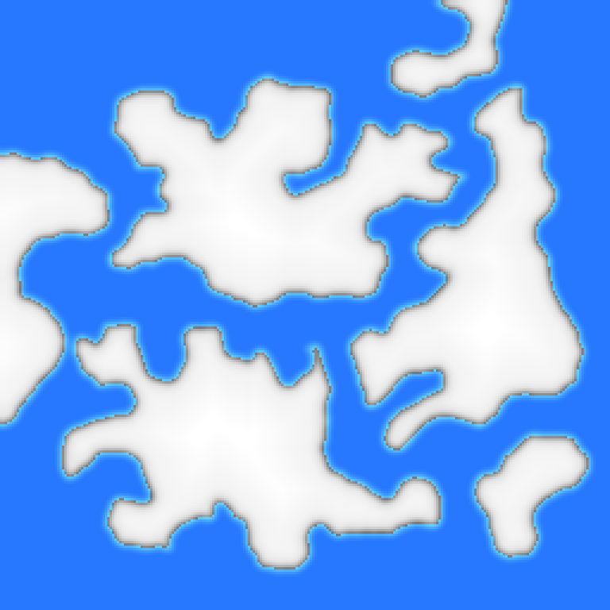
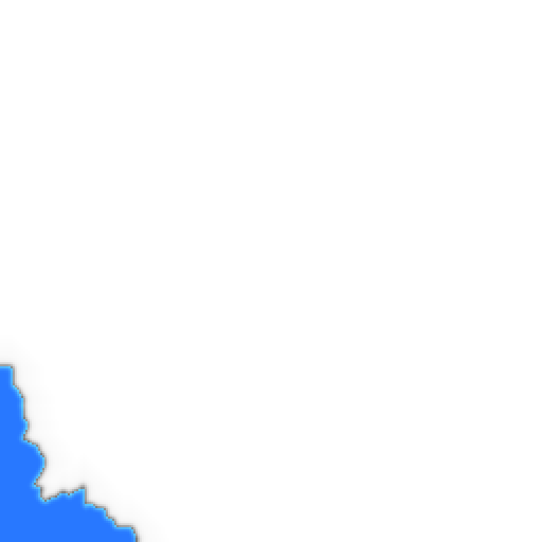
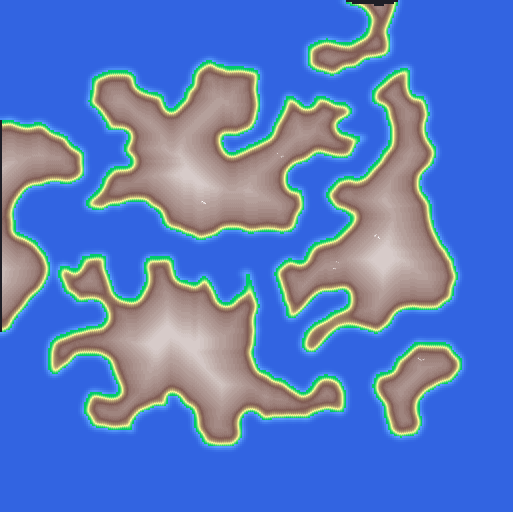

# Random map generation: where the sea and the land come from

A random map is generated **once** from its file name and then cached as an
ordinary `.m3d` (the format is [010_m3d.md](010_m3d.md); the topology built on
top of it is [020_topology.md](020_topology.md)). This chapter walks the
generator - `CreateRandomMap` -> `CreateMapByName` -> `CreateRandomTerrain`
(all in 3drandmap.cpp) - and answers the question the topology chapter leaves
open: **how does the generator decide which cells are sea and which are
land?**

## 0. The 60-second version

```
"RN0 3909 20213 00000EC6 0000000.m3d"     <- the name IS the recipe
  CreateMapByName: decode name -> ADDSH (size),
      seed mrpos, land type (style), players, mountains, resources, nations
        |
  Terrain\<style>.MSP inside the all.gsc archive (style file from Res.dat):
      'TSOC' chunk = table of N pre-baked terrain blobs; the seed picks
      variant (mrpos*N)>>15 (mrpos = seed & 8191); a blob = RLE 256x256
      SHAPE bitmap + player start places
        |
  shape bitmap: RLE-decoded into REND, then blurred NN = 30>>(ADDSH-1) passes
        |
  SEA vs LAND, per fine cell:  SqInt(shape) - 2048 = VAL (~ (byte-128)*16)
      Deep = 120 - (VAL>>4)  = 248 - shape_byte          (clamped 0..255)
      WaterDeep = ((Deep-128) >> (2-ADDSH)) + 128
      water  <=>  WaterDeep > 128  <=>  shape byte <~ 120 (of 255, ~47%)
      -> stored in the SEA2 ('2AES') chunk; WaterDeep>128 locks land
         (MFIELDS[0]) and opens water (MFIELDS[1]) in CreateWaterLocking
        |
  HEIGHT: THMap = hill relief + quadratic boost for bright shape areas
      (VAL>32: THMap += (VAL*VAL>>14)*24/100, ~60 at full white).
      Water (byte<120, VAL<0) gets no boost: THMap is NOT lowered under the
      sea - the sea exists only in WaterDeep, not in THMap (SURF chunk)
        |
  coast textures from Terrain\cost.dat, mines from Pieces\MINA*.LST,
  nature sprites, start places (TERR->NPlaces) -> CreateInfoMap
  -> back in CreateRandomMap: Save3DMap(Name) -> the .m3d file
  -> on load: CreateTotalLocking -> CreateAreas -> the topology (020)
```

## 1. The map name is the recipe

`CreateMapByName` decodes the name with
`sscanf(Name, "%s%x%x%s%d", cc1, &x1, &x2, cc2, &ADD_PARAM)`:

| field | example (`RN0 3909 20213 00000EC6 0000000.m3d`) | meaning |
|---|---|---|
| `cc1` | `RN0` | random map; `ADDSH = Name[2]-'0'+1` = 1 (size class: 1 normal, 2 large, 3 huge) |
| `x1` | `0x3909` | `mrpos` - the seed: picks the terrain variant and drives all `mrand()` rolls |
| `x2` | `0x20213` | packed dialog params: `Style = x2&15` (land type), `Play = (x2>>4)&15`, `Mount = (x2>>8)&15`, `Resst = (x2>>12)&15`, `Resmn = (x2>>16)&15` |
| `cc2` | `00000EC6` | per-nation peasant mask (which nations play) |
| `ADD_PARAM` | `0` | extra options (peace time, etc., `DecodeOptionsFromNumber`) |

The style (land type) indexes `RD.STY[Style]` from `Terrain\Res.dat`: the
six types are `0=Land, 1=Mediterranean, 2=Peninsulas, 3=Islands,
4=Continents, 5=Continent` (the `LT_*` enum in `ai_common.h`) - how they differ in
practice (island counts of the shipped maps) is measured in
[020_topology.md](020_topology.md) section 0. `STY[Style].Players[Play].name`
is the terrain file that is actually opened; `Terrain\terrlist.dat` maps
`(ADDSH, Mount)` to a concrete `.ter` name for the editor path.

## 2. The terrain file: N pre-baked shapes, the seed picks one

The terrain files do not live on disk - they are entries of the GSC resource
archive `gamedata/all.gsc` (format in src/game/arc/gscarch.cpp, extract with
`tools/gsc_extract.py`): `TERRAIN\RES.DAT`, `TERRAIN\COST.DAT`,
`TERRAIN\HILLS*.DAT`, `TERRAIN\MOUNT.DAT` and the per-style `TERRAIN\*.MSP`
(suhod*.msp, srediz*.msp, mediter*.msp, poluos*.msp, ostrov*.msp,
islands*.msp, kontin*.msp, contin*.msp - "suhod"=dry land, "srediz"=Mediterranean,
"poluostrov"=peninsula, "ostrov"=island, "kontinent"=continent).

`Terrain\Res.dat`'s STYLES section maps the land type index to the style
file per player count (`STY[Style].Players[Play]`, each entry = NPlayers +
file name):

| style (land type) | files by player count |
|---|---|
| 0 Land (`LT_Land`) | 2-4: `suhod4.msp`, 5: `suhod5.msp`, 6: `suhod6.msp`, 7: `suhod7.msp` |
| 1 Mediterranean | 2-4: `srediz4.msp`, 5-7: `mediter7.msp` |
| 2 Peninsulas | 2: `poluos2.msp`, 3: `poluos3.msp`, 4: `poluos4.msp`, 5-7: `poluos7.msp` |
| 3 Islands | 2: `ostrova2.msp`, 3: `ostrova3.msp`, 4: `ostrov4.msp`, 5-7: `islands7_1.msp` |
| 4 Continents | 2-4: `kontin2/3/4.msp`, 5-7: `islands7.msp` |
| 5 Continent | 2-4: `mediter4.msp`, 5-7: `contin7.msp` |

So the two case-study maps resolve to: `RN0 3909 ...` (style 3, Play 1) ->
`Terrain\ostrova3.msp`; `RN1 6F99 ...` (style 0, Play 1) -> `Terrain\suhod4.msp`.

`CreateRandomTerrain` opens that `.MSP` and expects a
`'TSOC'` chunk first (on disk the bytes read "COST" - tags are reversed
multichar constants, see [010_m3d.md](010_m3d.md) section 1):

```
u32 'TSOC', u32 N, then N+1 u32 blob offsets
mrpos = x1 & 8191                       <- seed masked, in CreateMapByName
variant = (mrpos * N) >> 15             <- the name seed selects the blob
blob = msp[table[variant] : table[variant+1]], a TerrainData block:
    i16 Lx, Ly (=256); u8 NPlaces, NIDS; u16 PLACES[8]; u8 PlayerID[8];
    u32 CompSize @30;  u8 Data[] @34 - RLE-compressed 256x256 shape bitmap
```

(The `PLACES` words are the packed player start positions used later by
`CreateNatDealing` - `Ntx = (PXY & 255) * msx >> 10`.) The RLE is trivial:
run lengths alternating between 0x00-fill and 0xFF-fill, decoded into a
65537-byte buffer `REND` (256x256 plus two 0xE3 integrity sentinels). The
bitmap is then blurred `NN = 30 >> (ADDSH-1)` times (30/15/7 passes for
normal/large/huge) with a 5-tap filter `(8*self + 4 neighbors) >> 4`, edges
clamped by copying border rows/columns.

`SqInt(REND, x, y)` bilinearly samples this 256x256 bitmap at length-unit
coordinates and scales bytes `<<4`, so a pixel value is `byte*16` and the
mid-gray 128 is 2048 (`SqMaxX = 480<<(ADDSH-1)*32`, i.e. 60 length units per
pixel on a normal map):

```c
int SqInt( byte* REND, int x, int y )     // bilinear sample of the shape bitmap
{
    if ( x < 0 )x = 0;  if ( y < 0 )y = 0;               // clamp to the bitmap
    if ( x >= SqMaxX )x = SqMaxX - 1;  if ( y >= SqMaxY )y = SqMaxY - 1;
    int cx = ( x << 8 ) / SqMaxX;  int cy = ( y << 8 ) / SqMaxY;   // 0..254
    int x0 = ( cx*SqMaxX ) >> 8;   int y0 = ( cy*SqMaxY ) >> 8;
    int dx = x - x0;               int dy = y - y0;
    int pos = cx + ( cy << 8 );
    int v0 = REND[pos] << 4,     v1 = REND[pos+1] << 4;
    int v2 = REND[pos+256] << 4, v3 = REND[pos+257] << 4;
    return v0 + ( ( v1-v0 )*dx )/SqDX + ( ( v2-v0 )*dy + ( ( v3+v0-v1-v2 )*dx*dy )/SqDX )/SqDY;
}
```

That one bitmap is the **whole landmass shape**: white = land, black = sea,
gray = shore/depth.

Rendered with `tools/terr_shape.py` (extracts the `.MSP` from `all.gsc`,
decodes the seed-selected variant, blurs, draws sea as blue where
byte < 120):



*The Islands shape bitmap behind `RN0 3909 ...` (the test2.sav.sav map):
`ostrova3.msp` holds N=100 variants, the seed picks variant 19. Its sea mask
(byte < 120 after blurring) agrees with the actually saved map's `SEA2`
`WaterDeep>128` mask on 256x256 samples to 98.8% - the saved .m3d really was
grown from this bitmap.*



*The Land shape bitmap behind `RN1 6F99 ...` (`suhod4.msp`, N=209 variants,
seed picks variant 25): one big white landmass with almost no sea (3.0%),
agreement with the saved map's water mask 100% - consistent with the
"Land map = one big island" result in [020_topology.md](020_topology.md)
section 0.*

## 3. Sea vs land: the byte-120 threshold

For every fine cell `(x, y)` (stages `'WATG'`/`'WBRI'`):

```cpp
int VAL  = SqInt( REND, x<<5, y<<5 ) - 2048;      // ~ (byte-128)*16
int Deep = 120 - ( VAL >> 4 );                   // = 248 - byte, clamped 0..255
WaterDeep[pos] = ( ( Deep - 128 ) >> ( 2 - ADDSH ) ) + 128;   // ADDSH=3: clamp [67,190], x2
WaterBright[pos] = ...;                          // from a second bitmap REND2 + noise
```

So **sea = shape-bitmap pixels darker than ~120 of 255 (~47%)**, because
`WaterDeep > 128 <=> Deep > 128 <=> 248 - byte > 128 <=> byte < 120`
(exactly `< 120` for ADDSH=3; `< 119`/`< 118` for ADDSH 2/1 due to the shift).
Depth grows as the pixel darkens (`Deep = 248 - byte`, up to 248 in the
deepest sea). `CheckDeep` is exactly `WaterDeep > 128`:

```c
bool CheckDeep( int x, int y )
{
    int x1 = x << 1, y1 = y << 1;
    if ( x > 0 && x < msx && y > 0 && y < msx )
        return WaterDeep[x1 + ( y << MapShift )] > 128;
    return false;
}
```

`CreateWaterLocking` then turns this into movement
masks, sampling 2x2 with `GetZ`: `WaterDeep > 130` -> water cell passable in
`MFIELDS[1]`, and `WaterDeep > 128` -> the same cell locked in `MFIELDS[0]`
(land). The map border is locked separately in `CreateMapLocking`.
The two grids are serialized into the **SEA2 chunk**
(`'2AES'` on disk reads "SEA2"): `u32 Lx = msx+2, u32 Ly = msy+2`, then `Ly`
rows of `(WaterDeep[Lx] bytes, WaterBright[Lx] bytes)` (`SaveWaterCost`).

Measured on the shipped maps (`tools/m3d_areas.py --water`):

```
RN1 6F99 ... (ADDSH=2, Land):  WaterDeep grid 962x962, values 0..248
RN0 3909 ... (ADDSH=1, test2.sav.sav map, Islands): grid 482x482, values
                              64..188 - most of the map is water, matching
                              the six-island layout of 020 section 4
```



*The `RN0 3909 ...` map (land type Islands) with the sea taken from the
stored `SEA2`/WaterDeep grid - blue where `WaterDeep > 128`, darker blue =
deeper (`WaterDeep-128`), land colored by `SURF` height, ridges and map border
darkened. The six islands of [020_topology.md](020_topology.md) section 4 are
exactly the bright blobs of the generator's shape bitmap.*

## 4. Height: THMap is land relief, the sea is not in it

Heights are built in the `'SETH'` stage:

```cpp
int HH = 24;
for ( v over all map vertices ) {
    int VAL = SqInt( REND, x, y ) - 2048;
    if ( VAL > 32 )                                  // bright = above mid-gray
        THMap[v] += ( ( VAL*VAL ) >> 14 ) * HH / 100; // quadratic boost, ~60 at white
}
```

plus hill relief from the `GenMap` machinery (`GenerateHill` /
`MakeHillSpot`, fed by `Terrain\Hills*.dat` / `Mount.dat` via `LoadTerrain`)
stamped on top; `THMap` is zeroed first. Crucially, water pixels
(`byte < 120`, `VAL < 0`) get **no boost and no negative clamp** - so
`THMap` under the sea stays at the flat ground base, exactly like plains.
Measured: on `RN1 6F99 ...` the modal height of the `WaterDeep > 128` cells
is 60, the same as flat land (heights 0..399 overall); on `RN0 ...` the whole
map is low-relief (0..67, sea level 0).

So the **sea is not a low value in the `SURF` height chunk** - it is a
separate mask (`SEA2`/WaterDeep), and the water surface is rendered from
`WaterDeep` alone (realwater.cpp). That is why the height figure in
[020_topology.md](020_topology.md) section 1 anchors its colormap at the sea
level (modal water-cell height) instead of the raw minimum - otherwise the
whole lowland lands in the blue band of the `terrain` colormap.

Coastline *textures* come from `Terrain\cost.dat` (stage `'COST'`): the shape
value is divided into `NTLines` cost bands (`tid = VAL / Divisor`), each band
mapping to a set of shore tiles in `TexMap` (stored with the high bit set,
`+128` - that is what the placement checks later treat as "not plain land").

### Fractal detail: what `GetFractalVal` is for

`fractal.cpp` builds a diamond-square fractal noise field `fMap[1024x1024]`
(`CreateFractal` -> `Generate(6)`: random values on a 16px grid, refined down
to 1px with halving amplitude starting at 2048, then normalized to 0..512
and smoothed once). `GetFractalVal(x, y)` bilinearly samples it at 1/32 scale
(`x/32 & 1023`). It has exactly two uses:

1. **Hill shaping** - in `GenMap::MakeLinearHill` when `UseFractal` is set
   (enabled for relief style 2 in `GenerateRelief`):
   the smooth hill profile `f` is multiplied by
   `(GetFractalVal(x, y) + 256) / 512`, so hills get fractal roughness instead
   of perfect cones;
2. **Ground texture variation** - `SetFractalTexture`
   (called at the `'FTEX'` stage of `GenerateWithStyle`):
   every vertex whose `TexMap` is still 0 (unset) or 255 (cleared center)
   gets one of 8 ground tiles, `TEXARR[clamp(GetFractalVal(ix<<8, iy<<8)/64,
   0..7)]`, so a large plain does not repeat a single tile visibly.

So the fractal is not the landmass shape (that is the hand-painted bitmap) -
it is the fine detail layered on top: hill roughness and texture jitter.

## 5. After the terrain: starts, mines, trees, stones, save

All of this happens inside `CreateRandomTerrain`, after the water/height/
coast stages and before the `.m3d` is written, so mines and trees end up
stored in the file as `TREE` sprites and `UNI3` units:

1. **`'NTDL'` - nation dealing**: start places from the
   terrain blob (`TERR->NPlaces`/`PLACES`, packed 0..255 xy, scaled
   `Ntx = (PXY & 255) * msx >> 10`) go to `CreateNatDealing`, which builds
   `NatDeals[]` (a coarse territory map, cell = 4 fine cells): nation start =
   `nat<<4`, water = `0xFF` (`InitNatDeal`), then
   `ExtendNatDealing` grows each nation's territory up to a radius of
   `60 << ADDSH` and collects the leftover land blobs into `FreeIsX/Y[]`
   (`NFreeIsl` "free islands" - land no nation got).
2. **`'STRS'` - trees, stones, start units** (`GenerateNationalResources`):
   per present nation, one random piece from
   `Pieces\TRSS.LST` (forest) and two from `Pieces\STNN0.LST` (stones), then
   `CreateCenterRound(x0, y0, 750)` clears a disc of radius 750 around the
   start (`TexMap = 255`) and `GenerateStartUnits` places the starting
   peasants.
3. **`'TERR'`** - `GenerateWithStyle(CurTerrName)`:
   `SetFractalTexture()` (the `GetFractalVal` ground tiles, section 4) plus
   stamping of `TERRAIN\PIECES\*.SMP` landscape pieces via a link system.
4. **`'TRES'` - mines**: `Pieces\MINA0.LST` is a flat list of mine pieces in
   triplets (gold, iron, coal: ids `3k`, `1+3k`, `2+3k`). Per nation: 2 of
   each metal at ring type `v+2` (600 attempts), then up to `NGold`/`NIron`/
   `NCoal` more of each at `v+3` (400 attempts) - the counts come from the
   name's `Resmn` nibble via `RD.MINES[Resmn]` in Res.dat (e.g. `RA_Medium`
   = 4 gold, 3 iron, 3 coal). Then, if free islands exist, 30 gold + 30 iron
   + 30 coal mines, 20 stones and 20 trees are scattered on them with type
   `0xFF` (20 attempts each).
5. **`'NATR'`**: `TexMap[v] &= 127` (coast high bits
   cleared to plain land), every sprite's `z` set from `GetHeight`, minimap
   rendered, `CreateInfoMap()`.

**Where exactly a piece may go** is decided by `ConditionalSetRandomPiece`:
`GetRandomPoint` rolls a ring radius
`R in [(type&15)<<2, ((type&15)+1)<<2 - 1]` around the nation start and
accepts a cell only if its `NatDeals` value lies in `[StartType, EndType]`
(i.e. inside that nation's territory - water is `0xFF`, never matched);
`type 0xFF` instead picks a random free island from `FreeIsX/Y`. Then every
vertex of the piece must land on `TexMap <= 127` (plain land - not coast
tiles, which have the high bit set, not a cleared center) and inside the
map; up to `NAttempts` rolls are tried before giving up. On success
`RM_Load` stamps the piece. So: **mines, trees and stones are added during
map generation, on land only (never on water/coast), concentrated in rings
around each nation's start, plus a fixed number on the free islands** - and
because the placement uses `NatDeals`, every nation starts next to its own
mines, which is what makes the early game fair.

Finally `CreateInfoMap()`, and back in `CreateRandomMap`:
`Save3DMap(Name)` writes the `.m3d` (chunks in [010_m3d.md](010_m3d.md)).

The topology itself is (re)built when the map is loaded/finalized:
`CreateTotalLocking()` -> `CreateAreas()` - [020_topology.md](020_topology.md)
section 2. A random map therefore ships with a ready-made `TOP1`/`TOPW`
topology in its `.m3d` cache; a mid-game autosave (`FastSave3DMap`) skips
those chunks and the graph is rebuilt from the terrain on load
(010_m3d.md section 5).

## 6. Why it looks like this

The generator is a 2001 "paint by numbers": a hand-authored 256x256 grayscale
sketch per land type, RLE-compressed and stored several variants per style
file; the map name's seed picks a sketch and jitter for resources/hills.
One threshold (byte 120) splits sea from land, and the same sketch also
feeds height and coastline texture, so the minimap, the relief and the
passability masks can never disagree. Today you would generate a heightmap
with value noise / Voronoi islands and derive water, navmesh and biomes from
it in one pass - the "one source bitmap, everything derived" idea is the same,
only the sketch is procedural instead of hand-painted.
