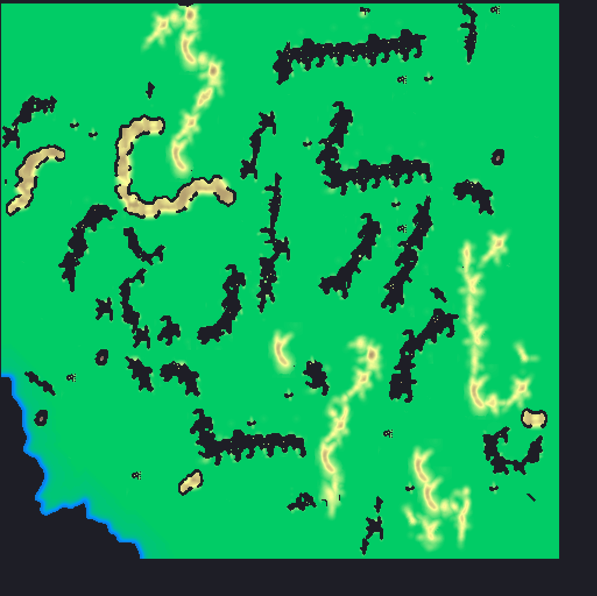
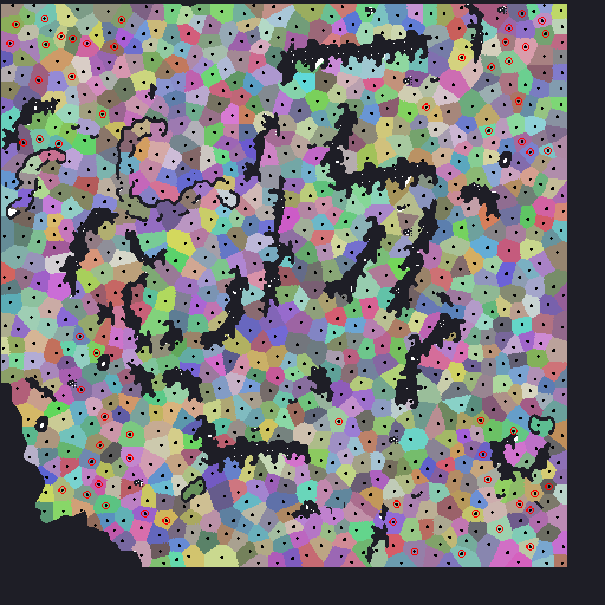
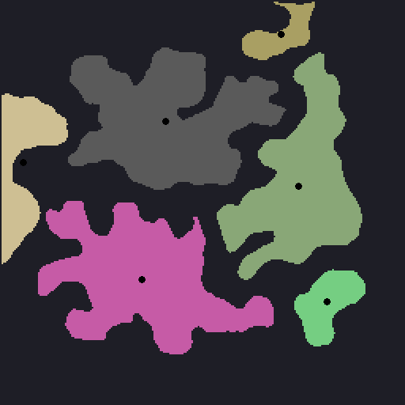
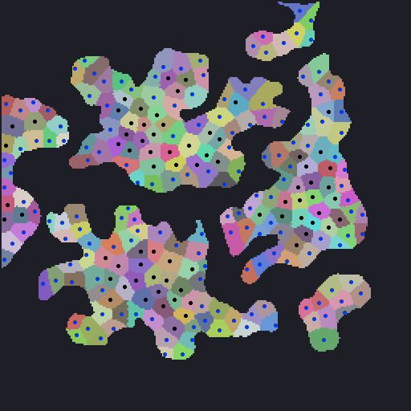
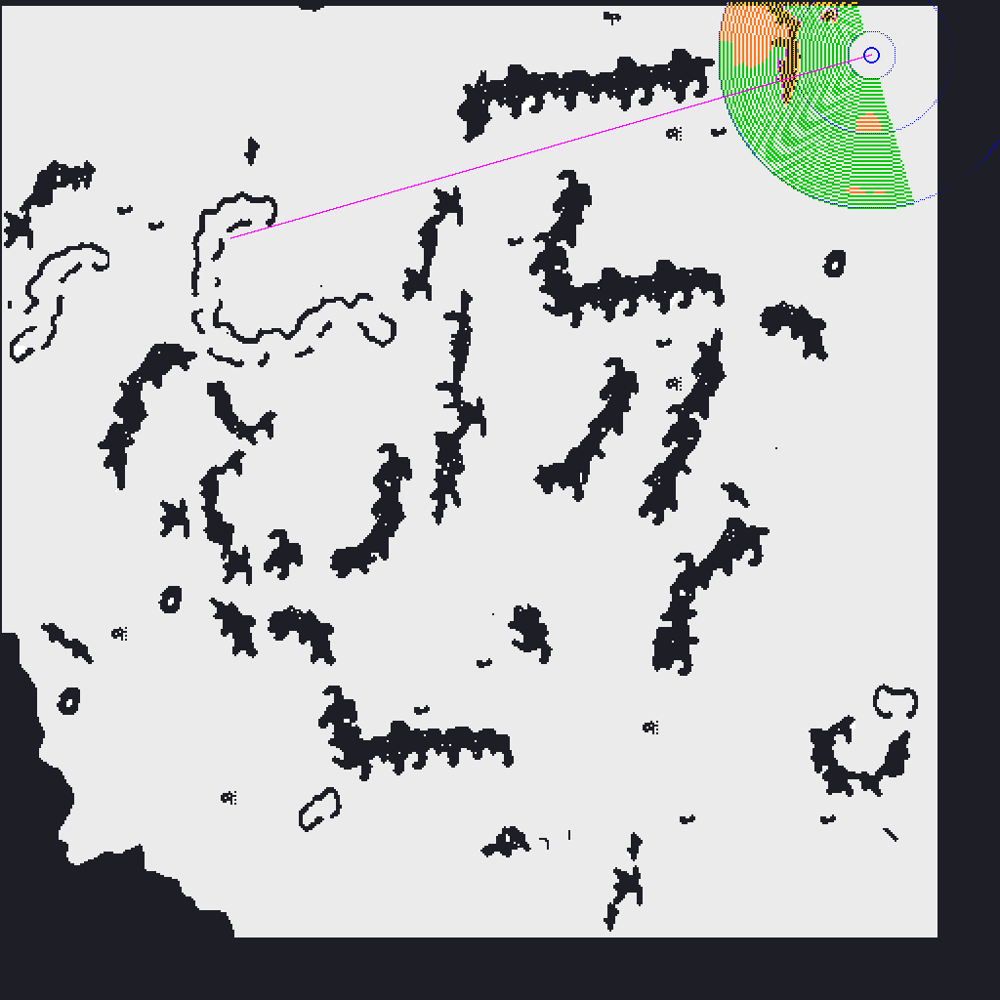

# The map's second skeleton: topology areas, links, and distances

This is a walk-through of the coarse "area graph" that the game builds on top
of the pixel map, and of everything that graph is used for. It assumes only
general programming knowledge plus [unit_rendering.md](unit_rendering.md) for
the coordinate vocabulary (length units, screen pixels, `RealX/RealY`). 

## 0. The 60-second version

The raw map is a fine grid of passability bits. On top of it the game builds a
**coarse graph of "areas"** - connected blobs of walkable land - and then answers
almost every strategic question with that graph instead of the raw grid:

```
raw map (msx x msy fine cells, MFIELDS / InfoMap / CantBuild)
        |
        |  CreateAreas() - once per map, at map finalization
        |    seed random free spots  ->  Area { x, y, Link[], MinesIdx[], SINF[8] }
        |    flood-fill TopRef ring by ring (Rarr, radius 1..89)
        |    touching areas -> AddLink(a, b, Norma(center distance))
        v
TopRef[x + y*TopLx] : word per coarse cell
        0xFFFF = impassable/locked, 0xFFFE = free land (no area), <4096 = area id
        |
        |  CreateLinkInfo(): seed LinksDist/MotionLinks from direct links,
        |  relax with OneIteration() (at most 3 passes)
        v
LinksDist[a*NAreas + b]  : word, 0xFFFF = unreachable, diagonal stays 0xFFFF (!)
MotionLinks[a*NAreas + b]: next hop area on the way to b
        |
        |  ResearchIslands(): connected components of the link graph
        |    -> TopIslands[area] = island id, NIslands, IslandX/Y, NearWater[]
        |
        |  kept up to date at runtime: walls/buildings lock cells
        |  (DynamicalLockTopCell), main loop calls ProcessDynamicalTopology()
        v
consumers: army pathfinding (brigade.cpp), mine capture, farm placement,
           building placement (SearchPlace/SearchTowerPlace), AI targeting
           and defense (megapolis.cpp, einfoclass.cpp), danger map (SafeMAP)
```

A normal map has a 256x256 topology grid and typically a few hundred to ~1000
areas (a skirmish map we instrumented had `NAreas = 960`; the hard cap in
`AddArea` is 1016).

### Map types at a glance: what the `.m3d` name tells us

Random-map names encode the generation parameters (`CreateMapByName`;
the lobby dialog `MPL_WaitingGame` assembles the name from the combo-box
choices):

```
"RN<size> <seed> <params> <nations> <extra>.m3d"
 e.g. RN0 3909 20213 00000EC6 0000000.m3d
```

* `size` = `Name[2] - '0' + 1` = `ADDSH`: 0 -> normal (`ADDSH=1`,
  `MAPSX=1024`, 256x256 `TopRef`), 1 -> large (`ADDSH=2`, 512x512), 2 -> huge
  (`ADDSH=3`, 1024x1024) - the grid math is in section 1;
* `params` (hex) packs the dialog choices: low nibble = **land type**
  (`RM_LandType = x2 & 15`), then `players<<4`, `mountains<<8`,
  `start-resources<<12`, `mines<<16`;
* land types (the `LT_*` enum in `ai_common.h`, also the `GetLandType()` doc
  comment in `activescenary.cpp`, and stored per map in the 12-byte `AIIA`
  chunk written by `SaveAIParam`): **0=Land, 1=Mediterranean, 2=Peninsulas, 3=Islands,
  4=Continents, 5=Continent**.

The land type decides how many islands the topology will have (section 4
computes them). Measured on the maps shipped in `gamedata/` with
`tools/m3d_areas.py --islands` (NIslands = connected components of the area
graph, areas per island in descending order):

| land type | example maps | ADDSH | NAreas | NIslands (areas per island) |
|---|---|---|---|---|
| 0 Land | `1.m3d`, `2.m3d`, `3.m3d`, `test.m3d`, `MyFirst.m3d` | 1 | 387-519 | **1** (one big island) |
| 0 Land | `RN1 6F99 ...` (the taras.sav/test.sav map) | 2 | 960 | 5 (931+22+5+1+1) |
| 0 Land | `olena2.m3d` | 2 | 904 | 17 (766+73+37+...) |
| 0 Land | `scene1.m3d` | 1 | 517 | 2 (516+1) |
| 1 Mediterranean | `tarastest.m3d` | 1 | 428 | 2 (427+1) |
| 3 Islands | `RN0 3909 ...` (the test2.sav.sav map, this chapter's sec. 4) | 1 | 236 | 6 (69+65+61+23+10+8) |
| 3 Islands | `RN1 4371 ...` | 2 | 419 | 7 (128+120+109+42+12+5+3) |

So a **Land map is essentially one big island** (occasionally with a few
one-area islets), Mediterranean is one dominant landmass plus a couple of
real islands, and an **Islands map is several comparable landmasses** - only
there does "which island is the enemy on" become a real question, and ships
(section 3's water graph) become mandatory. That question is answered by
`ResearchIslands()`, next. How the generator itself decides where the sea
and the land are (and hence how many islands a map has) is
[map_generation.md](015_map_generation.md)'s topic.

## 1. Why two maps over one terrain

The fine layer already exists: `MFIELDS[]` (movement fields), `InfoMap`
(buildability bits, newai.cpp `CreateInfoMap`) and `CantBuild` (locked cells,
`CB_Sklad/CB_Building/CB_Mill`, newai.h). It is per-fine-cell and changes
whenever a building appears. Walking armies do use it directly for local
movement. But it is far too fine for questions like "which mine is closest to
my town", "can I reach that enemy by land", "where should a tower go" - those
want a graph, not a bitmap.

So the game derives a second, coarser map:

| | fine layer | topology layer |
|---|---|---|
| grid | `msx x msy` cells (normal map: 512x512 fine cells) | `TopLx x TopLy` = `(MAPSX>>2)` = 256x256 cells |
| cell size | 1 fine cell | 4x4 fine cells = 64 length units = 4 screen px |
| values | passability/buildability bits | `word TopRef`: `0xFFFF` impassable/locked, `0xFFFE` free (no area), else area id (<4096) |
| built by | map load + `CreateInfoMap()` | `CreateAreas()` once per map |
| updated | continuously | incrementally, via `ProcessDynamicalTopology()` |

All figures below are rendered from the real map used by the case-study
saves `gamedata/taras.sav` and `gamedata/test.sav` - both store
`CurrentMap = "RN1 6F99 20210 000003JF 0000000.m3d"` (the `SaveMap` block of the
.sav, see [sav_format.md](sav_format.md)), a large random map (`ADDSH=2`).
`tools/m3d_areas.py` parses that `.m3d`'s `TOP1` chunk directly (chunk tags are
stored byte-reversed in the file - `TOP1` on disk is the C constant `'1POT'`,
`SURF` is `'FRUS'`, `TOPW` is `'WPOT'`; see [010_m3d.md](010_m3d.md) section 1), so the areas,
links and distances you see are the ones actually stored in the file, not a
sketch. All figures are plain square renders of the stored arrays - the same
view the in-game minimap shows (isometric projection applies only to units
and buildings, not to the map arrays; `TopRef` is indexed `x + (y << TopSH)`
and drawn cell-per-pixel).



*The `SURF` height chunk (1024x1025 words) in the matplotlib `terrain`
colormap, normalized so the sea level (the modal height of the water cells,
60 here - the flat ground base the generator leaves under water, since the
sea itself is the separate `SEA2`/WaterDeep mask, see
[map_generation.md](015_map_generation.md)) sits at the blue->green boundary:
lowland green, peaks brown/white. The `0xFFFF` impassable/locked cells
(water, ridges, map border) are darkened (one TopRef cell = a 2x2 block of
THMap vertices).*


*The `TopRef` grid (480x480 playable cells inside the 512x512 array): dark =
`0xFFFF` impassable/locked (water plus the map border), light gray = area ids
(passable land), white = the few `0xFFFE` free-but-unassigned cells (347 of
262,144 cells on this map).*

Map sizes are parameterized by `ADDSH`, taken from the map name digit in
`CreateMapByName` (normal=1, large=2, huge=3). The grid sizes come from
`SetupArrays`:

```c
MAPSX = MAPSY = 512 << ADDSH;
BMSX = 64 << ADDSH;
TopLx = TopLy = MAPSX >> 2;
TopSH = 7 + ADDSH;
```

So the topology grid is 256x256, 512x512 or 1024x1024.

`GetTopology(x, y)` is the lookup everyone uses: pixel coordinates in,
`x >> 6` to a cell, `TopRef[x + (y << TopSH)]` out. If the cell has no area
id (`>= 0xFFFE`) it scans rings up to radius 20 (`Rarr`) for the nearest
valid area, so a unit standing on a locked cell still maps to an area:

```c
int GetTopology( int x, int y )               // pixel coords in, area id out
{
    int xc = x >> 6, yc = y >> 6;
    word tr;
    if ( xc < 0 || yc < 0 || xc >= TopLx || yc >= TopLy ) tr = 0xFFFF;
    else tr = TopRef[xc + ( yc << TopSH )];
    if ( tr < 0xFFFE ) return tr;             // cell has an area
    for ( int i = 0; i < 20; i++ )            // else scan rings up to radius 20
        for ( int j = 0; j < Rarr[i].N; j++ ) {
            int xx = xc + Rarr[i].xi[j], yy = yc + Rarr[i].yi[j];
            if ( xx >= 0 && yy >= 0 && xx < TopLx && yy < TopLy ) {
                tr = TopRef[xx + ( yy << TopSH )];
                if ( tr < 0xFFFE ) return tr;
            }
        }
    return 0xFFFF;
}
```

`SafeTopRef` (in `mapdiscr.h`) is the bounds-checked raw variant.

## 2. Creating the areas: seeds, flood fill, links

`CreateAreas()` runs once when the map is finalized -
`CreateTotalLocking()` calls it after `CreateMapLocking()`
and before `CreateInfoMap()` - and the result is serialized into the map/save
files (`SaveTopology` in the `.m3d`, `LS_SaveTopology` in the `.sav`) and
reloaded with them.

**Step 1 - mark passable land.** `TopRef` is memset to `0xFFFF` (impassable /
locked - this is what water, ridges and the outer border keep), then every
cell where `GetTCStatus(x,y)` is true is set to `0xFFFE` (free land, no area
yet). `GetTCStatus` returns true for passable land: a 4x4 block of the movement
field (`MFIELDS->CheckBar`) plus an accurate 12-point `CheckPt` pattern.

**Step 2 - seed areas.** Random points are rolled; a seed is accepted if its
3x3 neighborhood is entirely `0xFFFE` (free land). `AddArea(x, y, Sliv)`
either merges the seed into an existing area within
`MinNorm` (7/10/15 cells for ADDSH 1/2/3 - averaging the center) or creates a
new `Area`. Seeding stops after 50 consecutive failed rolls. `NAreas` is
capped at 1016; `MaxArea` grows by 120 from 200. An `Area` is:

```cpp
struct Area {                 // topograf.h
    short x, y;               // center cell
    byte  Importance;         // mine bits: 1=gold, 2=iron, 4=coal
    byte  NTrees, NStones;
    word  NMines;  word* MinesIdx;   // resource sprites in this area
    word  NLinks;  word* Link;       // pairs {target area, weight}
    word  MaxLink;
    StrategyInfo SINF[8];            // per-nation strategic census, see sec. 5
};
```

**Step 3 - flood fill.** The loop `for (i = 1; i < RRad && Change; i++)` grows
every area by ring `i` using `Rarr[i]` - the precomputed ring-offset table
built by `CreateRadio()`: all (dx,dy) with
`int(sqrt(dx*dx+dy*dy)) == i`, for `RRad = 90`. A free cell (`0xFFFE`)
adjacent (8-neighborhood) to area `j` becomes `j`. When a cell of area `ZZ`
touches a cell of a *different* area `ZU`, both get a link:

```cpp
AddLink( ZZ, ZU );   // and AddLink( ZU, ZZ )
// AddLink: Link[N*2] = target; Link[N*2+1] = Norma(AR->x - TopMap[N2].x, AR->y - TopMap[N2].y);
```

So the **edge weight is the distance between area centers**, measured with
`Norma` (defined in `newmon.h`) - not Euclidean but the octagonal metric
`(2*max + min)/2`. Finally `TopRef[area center] = area id`.

**Step 4 - resources.** Every map sprite with `IntResType < 8` (a mine or
resource) is attached to the area containing its cell: `AR->NMines++`,
`MinesIdx[]`, and gold/iron/coal set `Importance` bits 1/2/4. This is how the
game knows "area 83 contains 2 gold mines" without scanning the map.

On the case-study map this produces **960 areas** (`NAreas=960` in the `TOP1`
chunk - exactly the `nareas=960` from the debug log), 4,960 directed links
with weights **min 11, max 39, mean 17.5**, and 60 mine-bearing areas (65 mine
references) (weights are `Norma` center distances, so they are small integers
by construction):



*Each color is one area of the real `RN1 6F99 ...` save; black dots are the
area centers (`Area.x/y`) where `TopRef` stores the id; red rings mark areas
with mine `Importance` bits. Dark cells are `0xFFFF` (impassable: water,
border); the few white cells are `0xFFFE` free-unassigned.*

## 3. The link matrices: `LinksDist` and `MotionLinks`

After the flood fill, `CreateLinkInfo()` builds two
`NAreas x NAreas` word matrices, indexed `[from*NAreas + to]`:

* `LinksDist[a][b]` - shortest known distance from area `a` to `b`;
* `MotionLinks[a][b]` - the **next hop** area on the way from `a` to `b`
  (used by pathfinding: "to reach b, go to MotionLinks[a][b] first").

Both are memset to `0xFFFF` ("unreachable"), then seeded only with *direct*
links from `Area::Link` (`ClearLinkInfo`), then relaxed by `OneIteration()`:

```cpp
void CreateLinkInfo() {
    ClearLinkInfo();
    int N, p = 0;
    do { ProcessMessages(); N = OneIteration(); p++; } while (N && p < 3);  // at most 3 passes!
    ...
}
```

`OneIteration` is a Bellman-Ford-style pass over all pairs, relaxing
`LinksDist[i][j] = min(..., LinksDist[N2][j] + linkWeight(i,N2))` and recording
the next hop in `MotionLinks`. Two quirks worth knowing:

1. **The diagonal is never written.** `OneIteration` skips `i == j`, and the
   memset leaves `LinksDist[a][a] = 0xFFFF`, not 0. Every caller that cares
   must special-case "same area" itself - `SearchPlace` does
   (`if (top == REALMYTOP) TDST = 0;`), and after the bug in section 8 so does
   `SearchTowerPlace`.
2. **Only up to 3 relaxation passes run** (`p < 3`), so pairs farther than
   what 3 Gauss-Seidel passes can propagate keep `0xFFFF` even when a path
   exists. In practice the grid-like area graph has small diameter, so this
   rarely matters - but "0xFFFF" therefore means "unknown/unreachable", not
   necessarily "no path".

**Water gets its own copy.** `CreateWTopMap()` builds the
same structure over `MFIELDS[1]` (water): `GTOP[1]` with `WTopRef`, `WTopMap`,
`WNAreas`, `WMotionLinks`, `WLinksDist`. Ships pathfind on it
(`MakeShipBattleLink`, `EnemyInfo::GetMaxForceOnTheWay`). In the save this is
the separate `TOPW` chunk.


*The real link graph of `RN1 6F99 ...` overlaid on the area map (dimmed). Edge
labels are the stored link weights - note they are all small integers
(center-distance metric).*


*`LinksDist[83][*]` from the saved matrices, drawn over the map: distance 0
is darkest, larger distances fade to bright, gray = `0xFFFF` unreachable,
black = `0xFFFF` impassable cells, white = `0xFFFE` free-unassigned cells. The
marked source is area 83 at (444,24) - Austria's base area in the top-right
corner of the map, next to the mine fields (6 of its 7 linked areas are
mine-bearing); only 84 of 960 areas are reachable from it, the nearest at
distance 14 (min link weight 14). You can also see the saved diagonal:
`LinksDist[a][a]` is `0xFFFF` for every area (740,797 of 921,600 matrix entries
in this map are `0xFFFF` overall) - exactly the quirk that broke first-tower
placement in section 8.*

## 4. Islands

`ResearchIslands()` runs a graph traversal (`ArrangeAreas`)
over `Area::Link` and labels every area with an island id in `TopIslands[]`,
then computes island centers. This is the answer to "is that enemy reachable
by land at all" - if his area is on a different island, only ships can get
there.

**Is a land map one big island?** Mostly yes - see the table at the end of
section 0: the `Land`-type maps in `gamedata/` come out as a single island
(`1.m3d`: `NIslands=1` over all 519 areas; the large case-study map
`RN1 6F99 ...`: 931 of 960 areas on one island, the rest tiny islets).
Mediterranean adds a few genuine islands (`tarastest.m3d`: 2), and an
Islands map - like this section's map, `RN0 3909 ...` from
`gamedata/test2.sav.sav`, land type 3 - is several comparable landmasses
(6 islands of 69/65/61/23/10/8 areas). So on Land/Continent maps
`NIslands` is 1-5 and the island logic below is mostly a formality; on
Islands/Mediterranean maps it decides who can attack whom by land.

Concretely, `TopIslands` is a `word[NAreas]` memset to `0xFFFF` ("unvisited"),
and islands are numbered from 0 in area-id scan order:

```cpp
void ArrangeAreas( int ID, byte IsID, int Deep ) {
    TopIslands[ID] = IsID;
    if ( Deep < 100 )                                  // recursion depth cap!
        for ( int i = 0; i < AR->NLinks; i++ ) {
            int D1 = AR->Link[i + i];                  // Link = {target, weight} pairs
            if ( TopIslands[D1] == 0xFFFF ) ArrangeAreas( D1, IsID, Deep + 1 );
        }
}
// ResearchIslands():
for ( int j = 0; j < NAreas; j++ ) if ( TopIslands[j] == 0xFFFF ) {
    ArrangeAreas( j, NIslands, 0 );
    for ( int p = 0; p < NAreas; p++ ) if ( TopIslands[p] == NIslands )
        ArrangeAreas( p, NIslands, 0 );                // 2nd pass, fresh depth budget
    NIslands++;
}
```

So an **island is a connected component of the area graph**. Two quirks: the
DFS depth is capped at 100, and the second pass re-runs the traversal from
every already-labeled area with the depth counter reset (that re-stitches
components the cap split; anything still unvisited would later get its own
island id from the outer loop). `NIslands` is asserted `< MaxIsl` (64), and
each island gets a center `IslandX[i]/IslandY[i]` - the average of its areas'
`x/y` centers. The same function then computes `NearWater[area]`: for every
land cell it scans the 7x7 neighborhood in the water grid `WTopRef` (the
separate `TOPW` chunk, section 3) and stores the water area whose center is
nearest (`Norma`) to the land area's center - i.e. which water area a ship
departing from this land area reaches first. `0xFFFF` = no water within 7
cells (deep inland).

Where islands are consumed:

| question | code | uses |
|---|---|---|
| which island is this nation on? | `ResearchCurrentIsland` | counts the nation's units per `TopIslands[TopRef[unit cell]]`; `CITY[Nat].MyIsland` = the island with the most units; `IslPrs[isl]` = bitmask `1 << NNUM` of nations with live units there |
| where may a transport land? | `FindCostPointEx` | a landing cost point is valid only on an island where some alive nation is present; cost points get `COSTPL[i].Island = TopIslands[Top]` (set in `CreateCostPlaces`) |
| can I reach the player by land? | `CheckDiversants` | `if ( CT->MyIsland != CITY[0].MyIsland ) AGRESS = &CT->Settlers;` - different island, so no diversion attacks, only defense |
| how big may a diversion be? | `MakeDiversionLink` | `IslPrs[CT->MyIsland] & 1` (the player is on my island) raises the member cap from 50 to 150 |
| where to build the fishing port? | `ResearchBestPortToFish` | the port farthest (`Norma`) from `IslandX/Y[CITY[0].MyIsland]` - as far from the player's island as possible |

The islands agree with the distance matrix by construction: links only connect
areas that touch during the flood fill (section 2), so `LinksDist[a][b]` is
`0xFFFF` for *every* cross-island pair - "different island" and "unreachable"
are the same relation.

The figures in this section come from a different save than the rest of the
chapter: `gamedata/test2.sav.sav` stores `CurrentMap = "RN0 3909 20213 00000EC6 0000000.m3d"`,
a normal `ADDSH=1` random map (256x256 `TopRef`, `NAreas=236`, water graph
`WNAreas=208`). `tools/m3d_areas.py --islands` re-runs the algorithm above on
the stored `TOP1` links (the save does not store `TopIslands` - the game
recomputes it after loading: both `LS_LoadTopology` and the `.m3d` topology
loader call `ResearchIslands()`):

```
Islands: NIslands=6 (MaxIsl cap is 64)  sizes desc=[69, 65, 61, 23, 10, 8]
         maxDFSdepth=38  secondPassLabeled=0
NearWater: areas with a water area within 7 cells=162/236
cross-island LinksDist pairs: 42296/42296 are 0xFFFF
same-island pairs reachable: 12273/13400 (236 are the 0xFFFF diagonal;
         the other 891 are same-island pairs the 3-pass relaxation never
         reached - the section 3 quirk)
```



*The six islands of `RN0 3909 ...` recomputed from the saved links: three large
ones (69 areas at center (89,176), bottom-left; 65 at (104,76), top-middle;
61 at (188,117), right), a medium one on the left edge (23 areas, center
(14,102)), and two small ones (8 areas top-right at (177,21); 10 bottom-right
at (206,190)). Dark = `0xFFFF` impassable (water separating the islands, plus
the map border). The DFS reached depth 38, well under the `Deep < 100` cap,
so the second pass labeled nothing new on this map.*



*`NearWater` from the `TOPW` water graph, drawn over the area map (same
per-area colors as the sec. 2 figure, center dots like there): 162 of 236
areas are "coastal" (blue dots) - the game uses this for port placement and
for picking landing zones, so areas deep inland inside the big islands have
black dots (`NearWater == 0xFFFF`).*

## 5. Per-area strategic census: `StrategyInfo`

`CreateStrategyInfo()` walks all objects, maps each to its
area via `TopRef`, and fills `Area::SINF[nation]`:

```cpp
struct StrategyInfo {
    word BuildInfo;      // SI_Center|SI_Meln|SI_Tower|SI_Shahta|... which building types exist here
    byte NPeasants, NShortRange, NLongRange, NMortir, NTowers, NPushek;
};
```

Afterwards it propagates `SI_Near` to all directly linked areas, so the AI
can tell "the neighboring area has a tower" without rescanning. The AI's
attack/defense code in megapolis.cpp 
reads these to pick targets and to decide when an army can "connect" to an
attack group (`MotionLinks[MyTop*NAreas + HisTop]`).

## 6. Who consumes the graph

| question | code | uses |
|---|---|---|
| army route between distant points | the `B_*Link` brigade orders: `B_GlobalSendToLink`, `B_CaptureMineLink`, `B_MakeBattleLink`, `B_HumanGlobalSendToLink` | `MotionLinks[from][to]` as next hop, recursively |
| ship route | `MakeShipBattleLink`, `EnemyInfo::GetMaxForceOnTheWay` | `GTOP[1].MotionLinks` (water graph) |
| can I capture this mine? | `TakeNewMineBrain` | mine's area reachable (`MotionLinks != 0xFFFF`) and within `MINE_CAPTURE_RADIUS` |
| where to put the next farm | `City::GetNextPlaceForFarm` | ring search, accept cell if `LinksDist[townArea][cellArea] - min < 30` |
| where to build | `SearchPlace` / `SearchTowerPlace` / `CheckTower` (newai.cpp) | ring search + `GetTopology` + `LinksDist` slack + `GetSafeVal` - see section 7 |
| where is the nearest enemy | `GlobalEnemyInfo::FindNearestEnemy` | ranks enemy armies/objects by `LinksDist[enemyArea][myArea]` |
| is this cell safe to build on | `EnemyInfo::GetSafeVal` | `SafeMAP` danger bitmap (built from enemy objects, dilated by 1 ring, refreshed every 256 ticks) |
| attack/defense decisions | `ArmyConnectToArmyLink` and the city AI | `MotionLinks` hops + `SINF` census |
| resource claiming | `FindResInCell`, `FindLimResInCell` | `LinksDist < 30 / < 20` reachability |

**Dynamical updates.** When a wall or building is created/destroyed,
walls.cpp calls `DynamicalLockTopCell` / `DynamicalUnLockTopCell`:
the cell flips between `0xFFFF` (locked) and `0xFFFE`
(free), and the area plus its neighbors are queued in `ChAreas`. Every frame
the main loop calls `ProcessDynamicalTopology()`, which remakes
only the affected area groups (`RemakeGroupOfAreas`) and re-relaxes distances
locally (`OnePartIteration` on temporary matrices, `LimitedClearBadLinks`).
So the graph - and therefore pathfinding, mine capture and placement - reacts
to new buildings within a frame or two, without rebuilding the whole map.

## 7. Building placement on the area graph: `SearchPlace` and the enemy-facing half-plane

The most frequent consumer of the area graph is the AI's city planner.
`City::FindApproximateBuildingPlace` (megapolis.cpp) picks what to build next
(`NewMonster::Usage`: `MillID`, `CenterID`, `SkladID`, `PortID`, `TowerID`,
`FarmID`) and, per type, calls `SearchPlace` with a type-specific predicate
and a search radius:

| building | predicate | radius `r` |
|---|---|---|
| mill (`MillID`) | `CheckMill` (5x5 block of empty cells) | 25 |
| center / sklad (`CenterID`, `SkladID`) | `CheckStoneWoodSklad`, else `CheckWoodSklad` / `CheckStoneSklad` (next to trees/stones), else `CheckBuilding` | 10-30 |
| port (`PortID`) | `CheckPort` (shoreline probe on `WaterDeep`) | 60 |
| tower (`TowerID`) | `SearchTowerPlace` + `CheckTower` (see below) | 40 |
| farm (`FarmID`) | `CheckBuilding` (2x2 empty cells) | 40 |

All coordinates are **"search cells"** - the `InfoMap`/`CantBuild` grid
indexed `x + y*VAL_SPRNX`, playable width `msx>>2 = 60<<ADDSH`. One search
cell = 2 `TopRef` cells = 128 px, which is why the code converts with
`GetTopology(x<<7, y<<7)` (it shifts `>>6` internally) and reads
`TopRef[xx+xx + (yy<<(TopSH+1))]`. The search origin is the city center
(`City::CenterX/CenterY`).

`SearchPlace(xx1, yy1, SFN, r)` (newai.cpp) then works like this:

1. Try the origin cell itself: `SFN(x, y)`.
2. Map the origin to its topology area (`GetTopology`); if the origin is in
   no valid area (`>= 0xFFFE`) the whole search fails.
3. Scan rings `i = 1..r-1` of the precomputed offset table `Rarr[i]` (applied
   on the search grid here, so ring `i` is `i` search cells = `2i` `TopRef`
   cells from the origin). For each ring cell:
   * skip if outside the playable map (`SsMaxX/SsMaxY = msx>>2, msy>>2`);
   * skip if `GNFO.EINF[CURRENTAINATION]->GetSafeVal(xx,yy)` is nonzero - the
     `SafeMAP` danger bitmap (one bitmap cell = 8 search cells, refreshed
     every 256 ticks from enemy objects; einfoclass.cpp `RefreshSafeMap`);
   * skip if the cell is in no valid area (`TopRef >= 0xFFFE`);
   * compute `TDST = LinksDist[originArea*NAreas + cellArea]`, with the
     same-area special case `TDST = 0` (the matrix diagonal stays `0xFFFF`,
     see section 3), and keep the cell only if `TDST - PrevTopDst < 24`, where
     `PrevTopDst` is the largest area distance accepted so far;
   * run the building predicate `SFN(xx, yy)`; the first hit wins and is
     written back to `*xx1/*yy1`.

The `LinksDist` slack (`< 24`) is what makes the ring search "area-aware":
the scan itself is in raw cell distance, but a cell only qualifies if its
*area* is within 24 of the best area found so far on the area graph. That
lets the search cross a gap (water, ridge) into a reachable area instead of
rejecting everything outside the origin's own area, while `0xFFFF`
("unreachable") fails the test by itself. Since rings are scanned in
increasing radius, the first predicate hit is approximately the nearest
acceptable cell.

### The enemy-facing half-plane in `SearchTowerPlace`

`SearchTowerPlace` (newai.cpp) is the tower-only variant, used while the
nation has at most one tower (`NPORTS <= 1`; after that it just delegates to
plain `SearchPlace`). It is the same ring search, but rings start at `i = 6`
(so the tower is not built right on top of the town center), and each cell
must additionally pass:

```cpp
(xx - xc)*(xe - xc) + (yy - yc)*(ye - yc) > 0
```

That is a dot product: (cell - base center) . (enemy - base center) > 0, i.e.
the cell lies on the enemy side of the line through the base center
perpendicular to the base-to-enemy axis - the tower faces the enemy. The
variables, all in search cells:

* `xc, yc` - the base center, `City::CenterX/CenterY`, assigned by
  `FindCenter` (newai.cpp) - the **center of mass of the nation's peasant
  units only** (`OB->newMons->Peasant`), averaged as `RealX>>4` then `>>7`:

```c
bool FindCenter( int* xx, int* yy, byte NI )  // nation NI's peasant center of mass
{
    int N = 0, x = 0, y = 0;
    for (int i = 0; i < MAXOBJECT; i++) {
        OneObject* OB = Group[i];
        if ( OB && OB->NNUM == NI && OB->newMons->Peasant ) {
            x += OB->RealX >> 4;
            y += OB->RealY >> 4;
            N++;
        }
    }
    if ( N ) { *xx = ( x / N ) >> 7;  *yy = ( y / N ) >> 7;  return true; }
    return false;
}
```
* `xe, ye` - the "enemy point", computed in the `TowerID` case of
  `City::FindApproximateBuildingPlace`: it loops
  over all objects in `Group[]`, skips dead ones (`Sdoxlo`), files the
  nation's own towers of this type into `NPORTS`/`PORTSX`/`PORTSY` (which
  `CheckTower` uses to keep towers at least 9 cells apart), and for every
  remaining object with `NNUM == 0` accumulates `exc += OB->RealX>>11`,
  `eyc += OB->RealY>>11`, then divides by the count.

So the enemy position **is a center of mass, but of all living objects of
nation 0 - units and buildings alike, not just units** (`RealX>>11` is the
same search-cell scale `FindCenter` produces: `RealX>>4` is the pixel
coordinate, `>>7` more converts to search cells). `NNUM == 0` is hardcoded
(it is original 2001 code): in single player the human is always nation 0, so
"nation 0" means "the player". Elsewhere the AI does this properly per nation:
`GlobalEnemyInfo::FindNearestEnemy` tests
`!(OB->NMask & EINF[NNUM]->Mask)` against the nation's enemy mask instead.
Edge case: if no nation-0 object is alive, `ne == 0`, so `xe = ye = 0` and the
half-plane degenerates to "the side away from the map corner (0,0)".

## 8. Case study: why Austria never built towers (and the fix)

This section is the field report from an actual skirmish on land map.
The AI side was fine. The tower died in `SearchTowerPlace`, which is used **only for a nation's first tower(s)** - once
`NPORTS > 1` (two or more existing towers) it switches to plain `SearchPlace`:

```cpp
if (NPORTS > 1) return SearchPlace( xx1, yy1, SFN, r );
```

The strict path searches rings 6..39 around the town center, but only cells on
the **enemy-facing half-plane** (`(xx-xc)*(xe-xc) + (yy-yc)*(ye-yc) > 0`),
that are danger-free (`GetSafeVal`), in a valid area, and whose area distance
passes `TDST - PrevTopDst < 14`. Coordinates here are in "search units"
(`SsMaxX = msx>>2 = 240`, one unit = 2 TopRef cells), so the logged
`(223,14)` is TopRef cell (446,28) - area **83**, whose center (444,24) is the
top-right corner of the map, right next to the mine fields (the enemy point
`(59,61)` is TopRef (118,122), area 864, on the top-left). The counters showed
why every candidate failed:

* `same-area=0`: area 83 was so small that no cell of it lay in the searched
  half-plane, and - the original bug - same-area cells would have had
  `TDST = LinksDist[83*NAreas + 83] = 0xFFFF` (diagonal!) anyway;
* `minTDST=14`: the nearest reachable area was exactly 14 away
  (`LinksDist[83]` min over reachable entries), failing `< 14`.

Result: `res=0` forever, `NPORTS` never exceeded 1, so the working
`SearchPlace` path was never reached - a nation that **can never build its
first tower**, purely because of where its base happened to generate. Hungary's
base area was small and well-linked, so it passed.

The fix (newai.cpp) mirrors what `SearchPlace` already did:

```cpp
int MyArea = MyTop;               // before MyTop *= NAreas
...
int TDST = LinksDist[MyTop + top];
if (top == MyArea) TDST = 0;      // same area = distance 0 (diagonal is 0xFFFF)
if (TDST - PrevTopDst < 24)       // same slack as SearchPlace (was < 14)
...
return SearchPlace( xx1, yy1, SFN, r );   // last resort instead of return false
```

After the fix the same map logs `TOWERPLACE res=1` and towers appear on the
enemy-facing side of the base, as they should.



*`SearchTowerPlace` replayed on `RN1 6F99 ...` exactly as the runtime did:
origin TopRef (446,28) = logged search cell (223,14), in area 83 (center
(444,24), top-right corner by the mines), enemy point TopRef (118,122) =
logged (59,61), area 864 (magenta line). Ring cells (search rings 6..39, i.e.
radius 12..78 TopRef cells; blue dots mark rings 6/20/39) on the enemy-facing
half-plane are colored by the furthest filter stage they pass: impassable
(yellow) -> topology distance rejected by `TDST - PrevTopDst < 24` with
same-area = 0 (orange) -> `CheckTower` 2x2 walkable fails (purple) ->
distance ok (dark pink) -> accepted (green). With the original `< 14`
threshold and no same-area rule, area 83's nearest reachable distance is
exactly 14, so *no* candidate could pass the distance stage - the exact
case-study failure (`tdst-ok=0, minTDST=14`). With the fixed `< 24` slack,
the green stage covers ~3000 cells and a tower spot is found.*

## 9. Why it looks like this, and what it would be today

The area graph is the 2001 answer to "pathfinding and strategy on a 512x512+
grid in software, every tick". A coarse graph turns O(map) questions into
O(areas) or O(1) matrix lookups; `LinksDist`/`MotionLinks` are just a tiny
Floyd-Warshall/Bellman-Ford and next-hop table, capped at 3 passes because
areas are grid-adjacent and the diameter is small. The `0xFFFF` sentinels and
the missing diagonal are exactly the kind of thing that survives when the
original authors special-case same-area at each *use site* (as einfoclass.cpp
and `SearchPlace` do) and forget one - which is what section 8 caught.

| technique here | modern equivalent |
|---|---|
| coarse area graph over a fine grid | navigation meshes / flow fields in modern RTS (e.g. Supreme Commander's flowfield, StarCraft 2's influence maps) |
| `LinksDist` + `MotionLinks` next-hop matrices | all-pairs shortest paths on a navmesh region graph (HPA* - hierarchical pathfinding, exactly this idea) |
| ring tables `Rarr[90]` for flood fill / searches | precomputed offset tables, or just `std::vector` of ring offsets; modern engines use jump-point search on grids instead |
| per-area strategic census (`SINF`) + `SI_Near` propagation | influence maps / tactical point analysis |
| dynamical lock/unlock of single cells with local re-relaxation | incremental navmesh updates (carving) in Unity/Unreal |
| separate water graph `GTOP[1]` | separate navmesh layers for land/sea |

The part that does **not** survive is trusting a 3-pass relaxation and a
never-written diagonal; a modern implementation would initialize the diagonal
to 0 and run until convergence, which is precisely the one-line class of fix
applied in `SearchTowerPlace` here.
