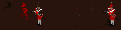
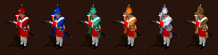
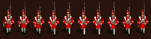
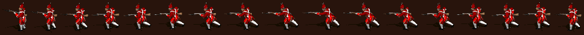
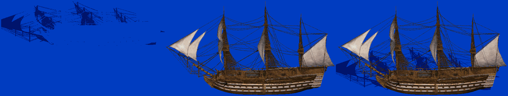
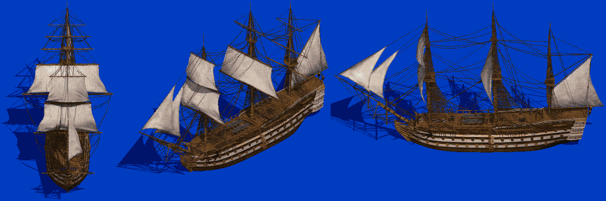

# How a Cossacks unit is drawn: the life of one grenadier

This is a walk-through of everything that happens between "a grenadier is
walking east, then throws a grenade" and colored pixels landing in the frame
buffer. It assumes only general programming knowledge: indexed color, the
sprite file format, the animation state machine, the nation recoloring, the
depth-sorted draw, and finally the palette and the SDL texture. All code
references are to this repository; every data example is real, extracted
from `gamedata/all.gsc`. The figures were produced by `tools/gp_render.py`,
a renderer that follows the game's own code path byte for byte.

The companion document [GPFormat.md](GPFormat.md) has the full, formal
sprite-format specification; this text explains the parts you need as they
come up.

## 0. The 60-second version

Cossacks is a sprite game. A unit is:

```
nmlist.txt --> LoadAllNewMonsters --> NewMonster["gre"]      the unit TYPE:
                                          loaded from GRE.MD (text) + a set
                                          of .gp sprite pages (GREG.GP, ...)

one grenadier on the map -----------> OneObject               the unit INSTANCE:
                                          position, facing, current animation
                                          and current frame number

MakeProcess (every simulation tick):
      picks the current animation (walk? aim? throw? die?)
      advances the frame counter NewCurSprite += FrmDec
      moves the unit by OneStepDX/DY (movement is tied to frames)

ShowNewMonsters (every rendered frame):
      computes the screen position, picks the sprite
      frame * Rotations + direction (mirrored if facing the "wrong" half
      of the circle), files a draw request into the Z-buffer

ShowZBuffer:
      draws the requests back to front (painter's algorithm,
      bucketed per scanline so it stays cheap)

ShowGPLayers --> ScreenPtr:
      unpacks the sprite's layers (shadow, nation-colored trim, body,
      semi-transparent parts) and writes palette indices into the
      8-bit screen buffer

CopyToScreen:
      wraps the buffer in an SDL surface with the game palette,
      scales it into an SDL texture, presents it
```

## 1. Background: indexed color and where sprites live

**Indexed color.** The game does not store RGB colors per pixel. Every pixel
everywhere is one byte, an index 0..255 into a 256-entry palette, and the
palette says which RGB each index means. The in-game palette is
`0\AGEW_1.PAL`: 768 raw bytes = 256 RGB triplets. "Drawing" in this engine
means copying, recoloring and blending *indices*; color only appears at the
very end, when the buffer becomes a texture. Section 10 explains what this
bought the game in 2001; here it is enough to know that it is true.

**The archive.** Almost all game data lives inside one big file,
`gamedata/all.gsc`. It is a simple archive: a table of (name, offset, size)
entries followed by the blobs. Names include `GRE.MD` (unit descriptions),
`GREG.GP` (sprite pages), `0\AGEW_1.PAL` (palette), and so on. The tools in
`tools/gsc_extract.py` and `tools/gp_render.py` read it directly.

**The .gp sprite page.** A `.gp` file is a container of small images. Think of
it as:

```
"GPAK" magic, N = number of sprite slots
N file offsets, one per slot          <- the offset table
for every slot: a picture header, then its pixel data
```

Each *picture header* (23 bytes, `GP_Header` in `gp_draw.h`) describes one
layer of one sprite:

```cpp
struct GP_Header {
    int   NextPict;         // offset to the NEXT layer of the same sprite,
                            // relative to this header; -1 = last layer
    short dx, dy;           // draw offset: pixels appear at (x+dx, y+dy)
    short Lx, Ly;           // width, height
    int   Pack;             // runtime cache pointer (on disk: 0xFFFFFFFF)
    byte  Options;          // low 6 bits = compression/layer type, see below
    int   CData;            // pixel stream: length<<14 | offset
    short NLines;           // number of rows (the real height)
};
```

**One sprite = several layers chained together.** This is the key idea. A
grenadier frame is not one picture: it is a chain of 4-7 small pictures
sharing one slot number, linked by `NextPict`, drawn back to back. Each
layer has its own compression type (the low 6 bits of `Options`):

| type | meaning | how the pixels reach the screen |
|---|---|---|
| 0 | standard packing | dictionary-LZ decompress, overwrite the screen byte |
| 1 | national mask | 2-bit values, each recolored through the nation's 4-color table |
| 2 | transparent 1/4 | 25% see-through: `screen = trans4[screen<<8 \| pixel]` |
| 3 | transparent 1/2 | 50% see-through: `screen = trans8[screen<<8 \| pixel]` |
| 4 | transparent 3/4 | 75% see-through, same table as type 2 |
| 5 | shadow | no pixels; darkens what is already on screen through a LUT |

The transparency "math" is not computed at runtime: `trans4`/`trans8` are
64 KB lookup tables shipped as `AGEW_TR4.GRD` / `AGEW_TR.GRD`, precomputing
every (old byte, new byte) -> result byte pair. The shadow type maps the
existing screen byte through a darkening table cut out of `AGEW_1D.GRD`.

**The per-line mask.** No layer stores a full rectangle. After the 23-byte
header comes one mask entry per row describing which column ranges are
opaque, and only those columns consume pixel bytes. A mask entry for a row
is either:

```
n                        <- n segments follow, each two bytes: (skip, count)
```

meaning "skip `skip` columns, draw `count` pixels from the stream, repeat",
or the wide-sprite variant (top bit set) where one byte packs a
skip-nibble and a count-nibble. So a layer is: one header + N mask entries +
one small compressed pixel stream. Transparency comes from the *mask*, not
from a magic color: a pixel value of 0 in a type-0 stream is the color with
index 0, not "transparent".

**Direction storage.** Unit sheets store each animation frame in several
turned variants. The layout is *rotation-major*:

```
sprite slot = frame * Rotations + direction
```

The grenadier's sheets use `Rotations = 9`: nine slots per frame. As
section 6 shows, the renderer maps the unit's facing into 16 direction
buckets and serves half of them by mirroring - so those nine stored images
(the ninth slot closes the direction loop) render 16 visually distinct
directions at 22.5-degree resolution.

**The .gpi side file.** A page may have a companion file with the same name
and extension `.gpi`: two byte arrays of `NPictures` signed bytes each. The
game loads them in `GP_System::LoadGP` (gp_draw.cpp):

```cpp
sprintf( Name, "%s.gpi", GPNames[i] );
f = RReset( Name );
if ( f != INVALID_HANDLE_VALUE ) {
    ItDX[i] = (char*) malloc( lpGPH->NPictures );   // per-sprite dx shift
    ItLX[i] = (char*) malloc( lpGPH->NPictures );   // per-sprite width
    RBlockRead( f, ItDX[i], lpGPH->NPictures );
    RBlockRead( f, ItLX[i], lpGPH->NPictures );
};
```

and applies the first one before drawing (`GP_System::ShowGP`,
gp_draw.cpp): `if (ItDX[FileIndex]) x -= ItDX[FileIndex][sprite];`. Why
would sprites need shifting? Each frame's `dx/dy` anchor the sprite to the
unit's world position (feet on the ground), and the per-line mask crops the
sprite to its content. When artists produce dozens of frames - or when
frames are traced from renders by hand, as these sheets were - the *content*
of consecutive frames can end up a few pixels off-center relative to the
cropped mask. Baking a per-sprite correction byte into a side file lets the
pipeline fix that without re-exporting any art; `ItLX` similarly overrides
a sprite's reported width for layout code (`GetGPWidth` prefers it). In
practice, none of the 1086 `.gp` pages in this game's `all.gsc` ships a
`.gpi` at all - the engine supports it, the shipped data does not use it.
(`tools/gp_render.py` reads one if present, to stay faithful.)

## 2. The unit type: a `NewMonster` built from a text file

At startup `LoadAllNewMonsters` (newmon.cpp) reads `nmlist.txt` - a plain
list of 342 unit identifiers - and calls `NewMonster::CreateFromFile(name)`
for each, which opens `<name>.md`. The grenadier is `gre`. Here is the top
of the real `GRE.MD`:

```
NAME Grenader
USERLC 1 greg  SHADOW -62 -91
USERLC 2 greb  SHADOW -62 -91
USERLC 3 grev  SHADOW -62 -91
USERLC 4 greh  shadow -62 -91
USERLC 5 grep  NONE -62 -91
USERLC 6 greu  SHADOW -62 -91
USERLC 7 greY  SHADOW -62 -91
#STAND     9 1   5 11
@MOTION_L  9 1 0 9
@MOTION_R  9 1 10 19
@MOTION_LB 9 1 19 10
@MOTION_RB 9 1 9 0
#TRANS01  9 10 6 4 6 3 6 2 6 1 6 0 3 0 3 1 3 2 3 3 3 4
#TRANS10  9 10 3 4 3 3 3 2 3 1 3 0 6 0 6 1 6 2 6 3 6 4
#PSTAND   9 1 6 4
#ATTACK   9 17 6 4 6 4 6 4 6 4 6 5 6 6 6 7 6 8 6 9 6 9 6 9 6 8 6 10 6 11 6 12 6 13 6 14
#ATTACK2  9 54 7 0 7 0 7 1 7 1 7 2 7 2 ... 7 25 7 25
#DEATH   9 20 4 0 4 1 4 2 ... 4 18 4 19
#DEATHLIE1 9 1 4 19
SETACTIVEPOINT #ATTACK1 2 57 83 39 80 26 74 20 66 21 58 28 51 37 46 49 42 65 42
GEOMETRY 1 10 32
WEAPON 2 NUCLGRE
RASTRATA_NA_VISTREL 1 2 IRON 1 COAL 1
```

`USERLC <slot> <name> SHADOW <dx> <dy>` registers a sprite page
(`GP_System::PreLoadGPImage`, gp_draw.cpp). The grenadier lists seven
sheets, but note which ones the animations actually use: `greg` is the
walking sheet, `grep` the standing pose, `greu` the grenade throw,
`grev`/`greY` the melee and long-range attacks, `greh` the death
animation. `greb` is registered but **never referenced by any animation
line in GRE.MD** - a dead entry, presumably a leftover from a sibling unit
or a plan that was cut (grenadiers do not build or repair, unlike the
peasant's sheets where every page is used). (The `SHADOW -62 -91` numbers
become the frame's `dx/dy` draw offset, not an actual shadow.)

Every animation line becomes a `NewAnimation` (`mapdiscr.h`) - a flat
array of frames:

```cpp
struct NewFrame {                 // mapdiscr.h
    word  FileID;                // which .gp page
    word  SpriteID;             // frame's base slot in that page
    short dx, dy;                // draw offset
};

class NewAnimation {              // mapdiscr.h
    byte NFrames;                // number of frames
    byte Rotations;              // direction slots per frame (9)
    byte HotFrame;               // frame at which the animation's sound plays
    short* ActivePtX, *ActivePtY;// per-rotation "muzzle" points
    NewFrame* Frames;            // Frames[i] = file + sprite of frame i
    ...
};
```

The two line formats (parsed by the `#`/`@` handlers in
`NewMonster::CreateFromFile`):

* `#NAME R N (file sprite) x N` - an **explicit frame list**. `#ATTACK 9 17 6 4 6 4 ...`
  means 9 rotations, 17 frames, sheet 6 (`greu`), base slots
  `4 4 4 4 5 6 7 8 9 9 9 8 10 11 12 13 14` - the grenade throw.
* `@NAME R file first last` - a **contiguous range**: `@MOTION_L 9 1 0 9`
  means 9 rotations, sheet 1 (`greg`), slots 0..9, one per frame.

The range check `(last+1) * Rotations <= sprites in file` in the `@`
handler is exactly the rotation-major layout from section 1, and the
numbers match the files: `GREG.GP` has 180 slots = 20 frames x 9
rotations (`MOTION_L` uses frames 0-9, `MOTION_R` frames 10-19), `GREU.GP`
also 180.

`GEOMETRY 1 10 32` precomputes the step-vector table that later couples
walking speed to animation frames (in the `GEOMETRY` handler of
`CreateFromFile`):

```cpp
MotionDist = 32;                                  // third GEOMETRY number
for (int i = 0; i < 256; i++) {
    OneStepDX[i] = ( TCos[i] * MotionDist ) >> 8; // 256-direction trig tables
    OneStepDY[i] = ( TSin[i] * MotionDist ) >> 8;
}
```

`SETACTIVEPOINT #ATTACK1 x0 y0 x1 y1 ...` fills `ActivePtX/ActivePtY` - one
grenade-release point per direction slot. When the throw fires, the attack
link code computes the spawn position from the point matching the current
direction (`AttackObjLink` / `AI_AttackPointLink` in newmon.cpp). The
`HotFrame` mechanism plays the throw sound at one specific frame
(`PlayAnimation`, newmon.cpp).

## 3. The unit instance: an `OneObject` on the map

Every unit on the map is an `OneObject` (`mapdiscr.h`). The fields that
matter for rendering:

| Field | Meaning |
|---|---|
| `RealX, RealY` | position in length units - 16 units = 1 screen pixel |
| `RealDir` | facing, one byte = full circle (0 = east, 64 = south, ...) |
| `newMons` | pointer to the `NewMonster` type |
| `NewAnm` | pointer to the **current animation** |
| `NewCurSprite` | index of the **current frame** within it |
| `LeftLeg` | which walk half-cycle is next |
| `Sdoxlo` | 0 = alive; 1 = dying (death animation starts) |
| `NNUM` | nation 0..15 - the recoloring index |

"What the unit is doing" for the renderer is exactly two of these:
`NewAnm` (which animation) and `NewCurSprite` (which frame). Everything else
in the class - orders, pathfinding, combat - exists to decide those two.

## 4. Choosing the animation - the state machine

There is no animation graph data structure. The "state machine" is the
unit's per-tick processing code assigning `NewAnm` directly.

**Walking** (`OneObject::ProcessNewMotion`, newmon.cpp). Walking alternates
two half-cycles - `MotionL` (left foot) and `MotionR` (right foot):

```cpp
if ( NewAnm->NFrames - FrmDec > NewCurSprite ) {   // animation not finished
    if ( MotionDir == 0 ) {                        // walking backwards:
        RealX -= NWM->OneStepDX[RealDir];          //   run the cycle in reverse
        RealY -= NWM->OneStepDY[RealDir];
    } else if ( MotionDir == 2 ) {                 // walking forwards
        RealX += NWM->OneStepDX[RealDir];
        RealY += NWM->OneStepDY[RealDir];
    }
    NewCurSprite += FrmDec;                        // next frame
} else {                                           // cycle finished:
    LeftLeg = !LeftLeg;
    if ( LeftLeg ) NewAnm = &NWM->MotionL;         // other half
    else           NewAnm = &NWM->MotionR;
    NewCurSprite = 0;
}
```

Note what is missing: there is no "speed" parameter. The unit moves exactly
one `OneStep` per animation frame, so walking speed is *defined by the
animation*.

**Aiming and attacking.** Combat animations are gated by a small state
number (`NewState`: 0 stand, 1 weapon down, 2 weapon ready, 3-4 shooting)
with transition animations between states (`TryToStand`, newmon.cpp):

```cpp
if ( n2 && NMN->TransMask[n1 - 1] & ( 1 << ( n2 - 1 ) ) )
    OB->NewAnm = &NMN->Trans01;    // raise weapon (stand -> ready)
else
    OB->NewAnm = &NMN->Trans10;    // lower weapon (ready -> stand)
...
NewAnimation* UA = &NMN->UAttack[OB->LocalNewState - 1];  // "unit attack"
OB->NewAnm = UA;
```

When the attack actually fires, the chosen `Attack[type]` plays (`ATTACK`,
`ATTACK1`, `ATTACK2` map to `Attack[0..2]` in the animation-name handler of
`CreateFromFile`), the weapon object (here `NUCLGRE`, the grenade) is
created at the animation's `ActivePt` position, and the sound plays at
`HotFrame`. The grenade itself is then just another game object with its
own animation and its own `.gp` page - the same machinery recursively.

Peasants add one more category of states that soldiers lack - work
animations - assigned the same direct way when the peasant reaches its
resource (`TakeResLink`, mapsprites.cpp): wood -> `WorkTree`, stone/gold ->
`WorkStone`, field -> `WorkField`, building site -> `Work`.

**Dying** (the death branch of `CalculateMotion`, newmon.cpp):

```cpp
if ( OB->Sdoxlo == 1 ) { OB->NewAnm = &NMN->Death; OB->NewCurSprite = 0; }
if ( OB->NewAnm == &NMN->Death ) {
    OB->NewCurSprite += FrmDec;
    if ( OB->NewCurSprite >= NMN->Death.NFrames - FrmDec ) {
        if ( NMN->DeathLie1.Enabled ) {          // corpse remains as one frame
            OB->NewAnm = &NMN->DeathLie1; OB->NewCurSprite = 0;
        } else { /* remove the object */ }
    }
}
```

### Frame rate: `FrmDec` and the Slow/Fast mode

Every frame advance above is `NewCurSprite += FrmDec`. `FrmDec` is 1 in
Slow Mode and 2 in Fast Mode (`SetGSpeed`, multi.cpp: `FrmDec = speed + 1`).
Because movement is one step per frame, "Fast Mode" literally means
"advance the animation two frames per tick" - the whole game speed switch
is this one increment. `SpeedSh` (= `FrmDec - 1`) is the matching shift
used where code counts frames in units, e.g. the sound hook
(`PlayAnimation`, newmon.cpp):

```cpp
int HF = NA->HotFrame;
Frame /= FrmDec;                 // normalize for fast mode
HF   /= FrmDec;
if ( Frame != HF ) return;       // only fire on the exact frame
AddEffect( x, y, NA->SoundID );
```

## 5. What is actually inside one sprite

Everything so far picked a `(FileID, SpriteID)` pair. Here is the real
layer chain of `GREP.GP` slot 11 - the grenadier's standing frame
(`#STAND 9 1 5 11`), direction 0:

| # | type | size | what it is |
|---|---|---|---|
| 1 | 5 - shadow | 34 x 18 | ground shadow blob |
| 2 | 1 - national mask | 15 x 38 | the 2-bit nation-colored trim |
| 3 | 0 - standard packing | 33 x 50 | the opaque body |
| 4 | 2 - transparent 1/4 | 34 x 50 | 25% see-through parts |
| 5 | 3 - transparent 1/2 | 32 x 51 | 50% see-through parts |
| 6 | 4 - transparent 3/4 | 30 x 49 | 75% see-through parts |

All six together are one grenadier:



*Tiles 1-6: the six chained layers of `GREP.GP` slot 11 rendered separately
(shadow, national trim, body, three alpha tiers). Last tile: the composed
frame - what the player sees.*

The design wins are:

* **One sprite serves all 16 nations.** Layer 2 is not color - it is a 2-bit
  *national mask*. `NatUnpackT` (gp_draw.cpp) expands each byte to four
  2-bit values (0..3 = dark..light), and the draw maps them through
  `NatPal`, a 16-nations x 4-shades table of palette indices:

  ```cpp
  static void NatUnpackT( byte* Dest, byte* Src, int Len )
  {
      int n = Len / 4;
      while (n-- > 0) {
          byte b = *Src++;
          *Dest++ = b & 3;          // four 2-bit values per source byte
          *Dest++ = (b >> 2) & 3;
          *Dest++ = (b >> 4) & 3;
          *Dest++ = (b >> 6) & 3;
      }
  }

  // ... in the type-1 branch of the draw:
  byte* enc = NatPal + ( Nation << 2 );      // 4 bytes per nation
  GP_ShowMaskedPalPict( x, y, lpGPCUR, tmp, enc );  // dst = enc[src]
  ```

  `NatPal` is hard-coded: nation 0 is red (indices 0xD0-0xD3), 1 blue, 2
  cyan, 3 purple, 4 orange, 5 black, 6 white, 7 mercenary colors.

* **Transparency costs one table lookup**, not a multiply: the alpha tiers
  index the 64 KB `trans4`/`trans8` tables shipped in the archive.

Same frame, different nations - only layer 2 changes:



*The standing grenadier (`GREP.GP` slot 11) rendered for nations 0 (red),
1 (blue), 2 (cyan), 4 (orange), 6 (white), 7 (mercs). Every other layer is
byte-identical.*

The walk cycle as stored in the file - `MOTION_L`, direction 0 (slots
`0, 9, 18, ... 81` of `GREG.GP`):



*The 10 frames of `@MOTION_L` (`GRE.MD`), direction 0. `MOTION_R` is frames
10-19 of the same sheet; the `_LB`/`_RB` lines reuse the same slots for the
mirrored directions and for walking backwards.*

And the grenade throw (`#ATTACK`, direction 0 - slots `4, 13, 22, ...` of
`GREU.GP`):



*The 17 frames of the ranged attack. The last frames carry the projectile
and its smoke trail inside the unit's own sprite; the flying grenade then
becomes a separate game object.*

## 6. From unit to draw request: `ShowNewMonsters`

Every rendered frame, `ShowNewMonsters` (newmon.cpp) walks all objects,
converts world to screen coordinates and files draw jobs:

```cpp
xx = ( OB->RealX / 16 ) - mapx * 32;      // 16 length units per screen pixel
yy = ( mul3( OB->RealY ) / 64 ) - mul3( mapy ) * 8;   // vertical squash

NewAnimation* NAM = OB->NewAnm;
int csp = OB->NewCurSprite;               // current frame
NewFrame* NF = &NAM->Frames[csp];
```

That `mul3` deserves a detour, because its definition is archaeological
evidence (mapa.cpp):

```cpp
int mul3( int x )
{
    return x + x;//x+x+x;
};
```

The name says "multiply by 3", the body multiplies by 2, and the commented
out `x+x+x` shows what the body used to do. This function is the single
tuning point for the map's vertical projection scale: every world-to-screen
Y conversion in the game goes through it. When the projection was adjusted,
one edit changed every use site at once - but the name was never updated.
So it is *not* obfuscation, it is a tuning knob whose value moved after the
name stuck. (It squashes vertical world distances by the same factor the
isometric tiles do.)

Then the **rotation** is resolved - this is where the nine stored slots
become sixteen directions:

```cpp
// NAM->Rotations = 9 (odd):
octs   = ( Rotations - 1 ) * 2;        // 16 direction buckets
oc2    = Rotations - 1;                 // 8
sesize = 255 / ( octs << 1 );          // rounding helper
oc1    = octs;                          // 16
ocM    = oc2;                           // 8 = first bucket of the plain half

byte dir = ( ( ( OB->RealDir + 64 + sesize ) & 255 ) * octs ) >> 8;  // 0..15
```

The unit's byte-angle facing (0..255 = full circle) maps onto 16 buckets -
22.5 degrees per bucket. Half the buckets are served by drawing a stored
slot **mirrored** (`GP_System::ShowGP` treats sprite numbers >= 4096 as
"flip horizontally"), which is why nine stored images are enough:

```cpp
if ( dir < ocM ) {                       // buckets 0..7: mirrored half
    AddPoint( xx, yy, ( xx - NF->dx ) >> ( 5 - Shifter ),
              ( ( zz + NF->dy ) >> ( 5 - Shifter ) ),
              OB, NF->FileID,
              oc2 - dir + NAM->Rotations * NF->SpriteID + 4096,  // +4096 = mirrored
              0, 0 );
} else {                                 // buckets 8..15: plain half
    dir = oc1 - dir;
    AddPoint( xx, yy, ( xx + NF->dx ) >> ( 5 - Shifter ),
              ( ( zz + NF->dy ) >> ( 5 - Shifter ) ),
              OB, NF->FileID,
              oc2 - dir + NAM->Rotations * NF->SpriteID,
              0, 0 );
}
```

The final slot number is `frame * Rotations + direction` (the layout from
section 1). `AddPoint` (zbuffer.cpp) does not draw - it buckets the sprite
into a per-scanline Z-buffer, which is how the game sorts hundreds of
overlapping units without a Z-test per pixel.

## 7. Sorting and drawing: `ShowZBuffer` -> `ShowGPLayers`

`ShowZBuffer` (zbuffer.cpp) sorts the buckets and calls `ShowZElement`
per sprite in depth order (underlays first, then special-case rules for
walls and flyers). `ShowZElement` resolves the final draw mode:

```cpp
int par1 = ZEL->Param1 & 0xF;        // AV_NORMAL / AV_TRANSPARENT / ...
int mask = ZEL->Param1 >> 9;         // which sprite layers may draw
if (!( ZEL->Param1 & 256 )) mask = 0xFFFF;    // normal units: all layers

byte nat = OB->NNUM;                        // nation for the recoloring
switch (par1) {
case AV_NORMAL:
    GPS.ShowGPLayers( smapx + ZEL->x, smapy + ZEL->y,
                      ZEL->FileID, ZEL->SpriteID, nat, mask );
    break;
case AV_TRANSPARENT: /* ghost mode: buildings drawn see-through */
...
}
```

`GP_System::ShowGPLayers` (gp_draw.cpp) walks the layer chain of the slot
and dispatches per compression type. All variants funnel into one generic
masked blit, `GP_ShowMaskedGeneric` (gp_draw.cpp), whose entire per-pixel
behavior fits in a comment:

```cpp
//   op 0: dst = src                    (GP_ShowMaskedPict           - body)
//   op 1: dst = Enc[(src<<8)|dst]      (GP_ShowMaskedMultiPalPict  - blend)
//   op 2: dst = Enc[src]               (GP_ShowMaskedPalPict        - NatPal)
//   op 3: dst = Enc[dst]               (GP_ShowMaskedPictShadow     - shadow LUT)
//   op 4: dst = Enc[(dst<<8)|src]      (GP_ShowMaskedMultiPalTPict  - alpha)
```

Rendering one unit is: for each of ~6 layers, unpack a small pixel stream,
walk its per-line mask and push palette indices into `ScreenPtr`. There is
no RGB anywhere in the hot path.

## 8. Palette, screen buffer, texture

Everything so far produced palette indices. They become colors only at
present time:

* `ScreenPtr` is a plain 8-bit buffer (stride `MaxSizeX`) - the game's
  backbuffer.
* The palette is `0\AGEW_1.PAL`, loaded into the SDL palette by
  `LoadPalette` (ddini.cpp).
* `CopyToScreen` (dialogs.cpp) copies the frame to `RealScreenPtr`, wraps
  it as an `SDL_PIXELFORMAT_INDEX8` surface with that palette, blits it
  scaled onto `primaryTexture` and presents it (details in
  [architecture.md](architecture.md)).

That is the whole trip: a text file -> animation tables -> per-tick state
machine -> one GP slot (six layers, mirrored if needed, recolored by
nation) -> depth-sorted palette blit -> SDL texture.

## 9. Same machinery, bigger canvas: the Victoria battleship (VIC.MD)

Everything above was measured on a grenadier, a 36x54-pixel figure. The
engine runs unchanged for the biggest sprites in the game: the ships. There
are 14 of them (every `NewMonster` whose `.md` says `MEDIA WATER` - `she`,
`link`, `vic`, `freg`, ...); `vic` is the Victoria, a first-rate ship of the
line, and the largest. Its `VIC.MD` keeps the exact same skeleton as
`GRE.MD` - `USERLC` pages, `#`/`@` animation lines, `GEOMETRY` - with three
differences that matter for rendering: a much bigger anchor, 65 stored
directions instead of 9, and animations that are mostly *one frame long*.

```
USERLC 0 vic      NONE -320 -458      <- anchor dx/dy (grenadier: -62 -91)
USERLC 1 vicbui   NONE -320 -458      <- "bui" = under construction
USERLC 2 ovic     NONE -320 -458      <- "o" = sheet with the nation flag layer
USERLC 3 ovicbui  NONE -320 -458
USERLC 5 vicdez   NONE -320 -458      <- sinking animation
USERLC 6 ovicdez  NONE -320 -458
MEDIA WATER
LINEARSORT 128
MOTIONSTYLE SHEEPS
#STAND    65 1 0 0
#MOTION_L 65 1 0 0
#MOTION_R 65 1 0 0
#MOTION_LB 65 1 0 0
#MOTION_RB 65 1 0 0
#DEATH     2 60  5 0  5 0  5 0 ... (60 pairs, all "5 0")
#DEATHLIE1 2 1 5 1
#ATTACK    65 3 0 0 0 0 0 0
#BUILDLO_0 1  2  1 0  3 0
...
#PSTAND1   65 1  2 0
MULTIWEAPON 360 418 0 19 245 450  255 437 ... (19 muzzle points)
GEOMETRY 1 120 16
RECTANGLE 0 62 232 240
WEAPON 0 PPOINTTKOR
ZALP 40
WAVES 215 296 24 4  247 250 190 254  249 264 188 260  251 256 190 262
```

**Size in the archive:** `VIC.GP` alone is 1,829,733 bytes - larger than
all seven grenadier sheets combined. The full page table and the
stored-vs-raw comparison are merged into the size tables of section 10
below.

### Sprite size on screen

The `USERLC ... NONE -320 -458` numbers are the frame's `dx/dy`: the sprite
is drawn with its origin at (unit position + (-320, -458)), i.e. the map
point sits at mid-hull, 458 px below the top of a nominal 640x916 canvas.
The real pixels are smaller than that canvas - measured from the layers:

| slot (of 65) | view | composed bbox | drawn px |
|---|---|---|---|
| 0 | bow-on | 244 x 432 | 45,925 |
| 16 | quarter | 466 x 379 | 76,910 |
| 32 | broadside | **597 x 330** | 79,043 |
| max layer in file | - | 590 x 453 | - |

A broadside Victoria covers a **597x330 px** rectangle - about 100x the
bounding-box area of the standing grenadier (36x54) and ~93x its drawn
pixels (846). That is why `RECTANGLE 0 62 232 240` exists: the click /
selection box is a separate 232x240 rectangle, much smaller than the art.

The layer chains are also simpler than a soldier's. Every `VIC.GP` slot is
exactly **two layers** - type 5 (shadow) + type 0 (opaque body); there is no
national-mask layer and no alpha tiers. The nation color lives only in the
`o`-sheets: every `OVIC.GP` slot is three layers (5, 1, 0), and the type-1
flag layer is tiny - 2,473 drawn pixels summed over all 65 directions.
`VICBUI.GP` (under construction) uses layer type 42, the "big picture"
LZ variant, for its hull-sized 384x298 frame. So the ship is drawn as:
shadow LUT pass + one masked overwrite - cheaper per pixel than the
grenadier, just over far more pixels.



*The two layers of `VIC.GP` slot 32 (broadside): shadow blob, then the
opaque hull. Last tile: the composed frame.*

### Number of directions: 65 instead of 9

`#STAND 65 1 0 0` says `Rotations = 65`. Plugging that into the same
rotation code from section 6 (odd branch, newmon.cpp `ShowNewMonsters`):

```cpp
octs = ( 65 - 1 ) * 2;        // 128 direction buckets, 360/128 = 2.8125 deg
oc2  = 64;  ocM = 64;  oc1 = 128;  sesize = 255 / 256 = 0;
byte dir = ( ( ( RealDir + 64 ) & 255 ) * 128 ) >> 8;   // 0..127
// dir < 64 : slot = 64 - dir + 65*frame + 4096  (mirrored, slots 64..1)
// dir >= 64: slot = 64 - (128 - dir) + 65*frame   (plain,    slots 0..63)
```

So the renderer maps the byte-angle onto **128 buckets of 2.8 degrees**,
filled by the **65 stored slots** - each of slots 1..63 serves one plain
bucket and one mirrored bucket, so the 65 distinct images (~5.5 degrees
apart) cover the full circle at 2.8-degree resolution. The grenadier's 9
slots fill 16 buckets of 22.5 degrees the same way. `VIC.GP` has exactly 65 slots because one frame x 65 rotations
fills the page: the whole sheet *is* the direction ring of a single pose.



*Slots 0, 16, 32 of `VIC.GP` - three of the 65 stored directions, from
bow-on (slot 0) through quarter view (slot 16) to broadside (slot 32), on a
water-blue backdrop.*

### Animations compared to the grenadier

| animation | grenadier (`GRE.MD`) | Victoria (`VIC.MD`) |
|---|---|---|
| `STAND` | 9 rots x 1 frame (`GREP` slot 11) | 65 rots x 1 frame (`VIC` slot 0) |
| `MOTION_L/R/LB/RB` | 9 rots x 10 frames each, contiguous ranges in `GREG` | 65 rots x **1 frame**, all the same slot as `STAND` |
| `ATTACK` | 9 x 17 frames in `GREU`, `ATTACK2` 9 x 54 | 65 x 3 frames, **all the same slot** (`0 0 0 0`) |
| `DEATH` | 9 x 20 frames in `GREH` | **2 rots x 60 frames of one slot** (`VICDEZ` slot 0) |
| `DEATHLIE1` | 9 x 1 (corpse) | 2 x 1 (`VICDEZ` slot 1, the wreck) |
| construction | - | `BUILDLO_0..3` on `VICBUI`/`OVICBUI` |
| `PSTAND` | 9 x 1 (`GREY` slot 4) | `#PSTAND1`: 65 x 1 on `OVIC` (the flag-carrying sheet) |

Three things follow from the table:

* **The ship has no walk cycle.** `MOTION_L/R/LB/RB` all point at frame 0
  of `VIC.GP`, so "moving" is expressed purely by changing position and
  rotating through the 65 direction slots - there is nothing to bob. This
  matches the movement code: `MOTIONSTYLE SHEEPS` selects
  `PerformMotion2` (motion.cpp), a velocity-based mover (`RealVx/RealVy`,
  not the frame-locked `OneStepDX/DY`), and calls `CreateTrace`
  (shiptrace.cpp), which draws the wake ripples from the `WAVES` line (4
  wave points around the hull). `GEOMETRY 1 120 16` gives `MotionDist = 16`
  = 1 px per frame, half the grenadier's 2 px per frame (`MotionDist = 32`).
* **The attack animation is a placeholder; the cannon fire is another
  object.** `#ATTACK 65 3 0 0 0 0 0` replays the standing frame 3 times.
  The actual broadside is `WEAPON 0 PPOINTTKOR` (cannonball) spawned at the
  19 `MULTIWEAPON` muzzle points along the hull, `ZALP 40` shots per salvo
  (`MaxZalp`, counted down in `NZalp`) - the same "projectile as a separate
  game object" trick as the grenade, but with 19 spawn points instead of
  one `ActivePt`.
* **Death is a held frame, not a sequence.** `#DEATH 2 60 5 0 ...` lists
  60 frames that all point at slot 0 of `VICDEZ.GP` (2 rotations): the
  sinking ship is one static image shown for 60 ticks, and once
  `Sdoxlo > 100` `ShowNewMonsters` files it with `AV_TRANSPARENT` - the
  wreck fades into the water instead of playing frames. `DEATHLIE1` leaves
  slot 1 as the permanent wreck.

One more ship-only line: `LINEARSORT 128` sets `LinearLength`, and in
`ShowNewMonsters` that switches `AddPoint` to `AddLine` - the sprite is
inserted into the Z-buffer as a **line segment 128 px long along the
facing** (`dx = 64*cos(dir)`, `dy = 64*sin(dir)/2`), so the 600-pixel hull
is depth-sorted scanline by scanline along its length and other objects can
correctly overlap the bow or the stern. A grenadier's 36-pixel figure is
sorted as a single point; a battleship needs the line.

## 10. Why the format looks like this: RAM, bandwidth, 2001

The design is usually filed under "disk compression", but disk was the
least of it. The real budgets of a 2001 software renderer were RAM,
framebuffer bandwidth and CPU - and the format optimizes all three.

**Memory footprint, measured.** Two real sheets, counted straight from
`all.gsc` - the grenadier's walking sheet `GREG.GP` (180 slots) and the
Victoria's direction ring `VIC.GP` (65 slots, see section 9):

| representation | `GREG.GP` | `VIC.GP` |
|---|---|---|
| as stored in the archive, all layers compressed | 215 KB | 1,786 KB |
| the same pixels as raw 8-bit indexed bitmaps | 1.27 MB (6x more) | 15.2 MB (8.7x more) |
| the same pixels as raw 32-bit RGBA | 5.09 MB (24x more) | 60.7 MB (35x more) |
| bounding-box pixels of all layers, counted from the file | 1,333,928 | 15,910,888 |
| actually drawn (per-line mask) | 12% | 28% |

The Victoria's pages, all measured in the archive (`VIC.MD` references the
six without the `T` suffix):

| page | slots | size in archive | contents |
|---|---|---|---|
| `VIC.GP` | 65 | **1,829,733 B** | the ship, all directions |
| `OVIC.GP` | 65 | 740,625 B | ship + nation-flag layer |
| `OVICT.GP` | 65 | 740,625 B | byte-size twin of `OVIC.GP`; no unit `.md` references it |
| `VICBUI.GP` | 4 | 226,509 B | construction stages |
| `OVICBUI.GP` | 4 | 49,293 B | construction stages + flag |
| `VICDEZ.GP` | 4 | 114,560 B | sinking / wreck |
| `OVICDEZ.GP` | 4 | 53,597 B | sinking / wreck + flag |

One ship page, `VIC.GP`, is 7.7x larger than the grenadier's biggest sheet
(`GREU.GP`, 239 KB) and larger than all seven grenadier sheets combined
(1.43 MB); the six pages `VIC.MD` references total ~3.0 MB. A "plain RGBA
texture" version of one unit sheet would have been **24 times larger on
disk and in RAM** (35x for the ship) - and the game carries hundreds of
sheets, on machines with 64-128 MB of RAM. At the
player's typical 1440x900 resolution, the *framebuffers alone* would cost
5.2 MB each in RGBA versus 1.3 MB indexed - and the game keeps two of
them.

**Bandwidth, measured.** Software rendering means every visible pixel is
written by the CPU across the memory bus. Indexed color quarters the bytes
moved per pixel versus RGBA (one byte instead of four). On top of that,
the per-line mask means skipped pixels cost *nothing at all* - no read, no
write, no blend. For `GREG.GP` only **12% of the layers' bounding-box area
is actually drawn** (28% for `VIC.GP` - a hull fills its rectangle more
than a running soldier); the rest of the sprite rectangles never touch
memory. A naive RGBA blitter would read, blend and write every one of those
pixels (even with alpha testing, it still reads the source and tests).

**Art sharing.** Baking the 16 nation colors into the sprites would
multiply every sheet by 16. Instead the nation tint lives in the small
2-bit trim layer - for the throw frame above it is 234 pixels out of 848
drawn, i.e. **28% of the drawn pixels carry all the nation variation**,
and the other 72% is shared by all nations. `NatPal` itself is 64 bytes.

**And the apparent cost - the layers - is nearly free.** The layers are
not "extra work compared to a flat sprite": the opaque body pixels are
plainly overwritten (no blending), the trim is a tiny rectangle, and the
alpha tiers only pay a table lookup on the pixels they actually draw. A
flat sprite with true alpha would *blend every pixel*; the tiered version
blends only the genuinely semi-transparent minority. Layers exist to
share art, not to spend compute.

Finally, the compressed pages stay compressed in RAM (the archive is
memory-mapped), and `LoadGP`'s cache unpacks only the frames that are
actually drawn this frame - classic streaming for machines that could not
hold even the indexed version of everything at once.

## 11. The same ideas elsewhere

Nothing here is exotic; this is what sprite engines of the era looked
like, each solving the same problems (indexed color, player recoloring,
translucency without an alpha channel, direction sheets):

| Technique here | Same idea in other engines |
|---|---|
| 8-bit indexed sprites + per-player recolor | Age of Empires' SLP sprites: per-player color indices marked in the file, per-line RLE, 8 facings with mirroring - documented by the openage project: [slp-files.md](https://github.com/SFTtech/openage/blob/master/doc/media/slp-files.md) |
| Player/nation color as reserved index ranges | StarCraft's GRP sprites (player colors are a remapped index range; see the OpenBW reimplementation, github.com/OpenBW/OpenBW) |
| Per-line RLE masks | Westwood's SHP format in Command & Conquer (RLE per scanline, remap tables for team colors); console tile engines back to the NES |
| 64 KB precomputed blend tables (`trans4`/`trans8`) | Doom source ports' `tranmap` for translucent sprites - see [doomwiki.org/wiki/Translucency](https://doomwiki.org/wiki/Translucency) |
| Dictionary-LZ / LZSS variants | Every engine rolled its own; GP's `StdUnpack` is LZSS against a static dictionary |
| On-demand unpack cache | Doom's zone allocator, Build engine caches - software-renderer streaming |

**What it would be today.** The jobs of this format are now split between
boring file formats and shaders: PNG/WebP spritesheets (or GPU-native
compressed textures like KTX2/Basis) packed into atlases; a real alpha
channel instead of the 1/4-1/2-3/4 tier trick (GPU blending is free);
nation colors as either baked variants (disk is cheap) or a palette-swap
shader - upload index data in one texture and a color LUT in another,
which is literally `NatPal` executed per-pixel on the GPU. The 8-direction
sheet plus mirroring survives in modern isometric games (Factorio renders
its sprites this way), because it halves art cost for free. What died is
the premise: a CPU that has to be talked out of touching transparent
pixels.

