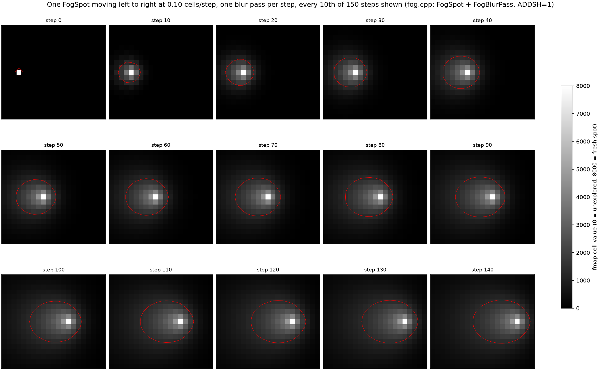
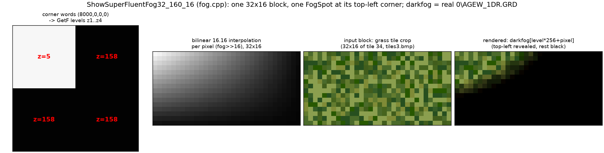
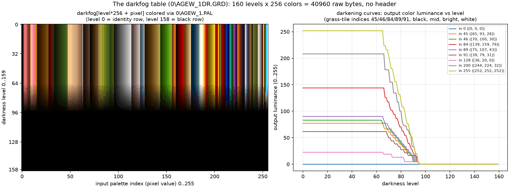

# Fog of war: how Cossacks hides the unexplored map

This chapter walks through the fog-of-war system end to end: the data it
lives in, how explored areas are recorded and blurred, how the fog is
drawn over the finished frame, and who actually consults it. All of the
logic lives in one file, `src/game/fog.cpp`; the data lives in
`gamedata/all.gsc`. It assumes the coordinate vocabulary from
[040_unit_rendering.md](040_unit_rendering.md) and
[020_topology.md](020_topology.md).

## 0. The 60-second version

The fog is a **low-res grid of 16-bit counters**, one per 128x128 map
pixels, plus a set of precomputed byte lookup tables that darken pixels:

```
fmap: LX_fmap x LX_fmap words (LX_fmap = 134 << (ADDSH-1)), 3-cell border
  0 = unexplored, 8000 = freshly revealed spot, decayed by blur
        |
        |  every simulation step, per own unit / scenario light:
        |    UnitLight(OB) / ScenaryLights() -> FogSpot(x, y)
        |    writes kFogRevealValue (8000) into the fog cell under (x, y)
        |
        |  every rendered frame (if FogMode and game not paused):
        |    FogBlurPass(): copy fmap -> fmap1, then for each cell
        |      dst = (sum of 4 neighbours >> 2) - (sum >> 10)
        |      (blur that spreads revealed areas and slowly fades them)
        |
        |    CreateFogImage(): upsample fmap into per-screen-pixel WFSC
        |      (each fog cell = 4x4 screen pixels, 5x5 bilinear control grid)
        |
        |    DrawFog(): per 32x16 screen block, GetF() maps each corner word
        |      to a darkness level 5..158, ShowSuperFluentFog32_160_16()
        |      bilinearly interpolates the corners in 16.16 fixed point and
        |      remaps every pixel: dst = darkfog[level*256 + dst]
        |
        |    DrawMiniFog(): blacks out fogged cells on the minimap
        v
queries: GetFog(x, y << 1) < 900  =>  "fogged" - used only for player-facing
         things: sounds (gamesound.cpp) and click hints (mapa.cpp).
         The AI never calls it.
```

## 1. The fog grid: `fmap`

The whole state of the fog is one array of `word`, `fmap`, sized
`LX_fmap * LX_fmap` with `LX_fmap = 134 << (ADDSH - 1)` (`ADDSH` = 1..3 is
the map-size selector, so the grid is 134, 268 or 536 cells per side).
It is allocated in `loadsave.cpp` when a game starts, together with
`fmap1` (a scratch copy) and the row-stride globals `FMSX = LX_fmap`

A cell covers `kFogCellSize = 128` map pixels, and the grid carries a
`kFogOffset = 3`-cell border around the playable map so that coordinates
near the edge can be rounded into valid cells (`FogSpot` clamps to
`[1..maxFX] x [1..maxFY]`, where `maxFX = msx/4 + kFogOffset`).

Cell values are simple counters:

* `0` - unexplored (the initial state; `ClearFog()` memsets both grids to 0),
* `kFogRevealValue = 8000` - written by `FogSpot()` when a unit sees the cell,
* anything in between - the result of the diffusion pass, i.e. "seen some
  time ago, now fading".

Two thresholds interpret the value: `GetFog()` reports "fogged" below
`kFogVisibleThreshold = 900`, and `DrawMiniFog()` paints the minimap black
below `kMiniFogThreshold = 1300`.

## 2. Revealing the map: `FogSpot`, `UnitLight`, `ScenaryLights`

`FogSpot(x, y)` converts a map point to a fog cell (`(x + 64) / 128`, the
`+64` rounding to the nearest cell) and sets that cell to 8000.

Who calls it:

* `UnitLight(OB)` - called for every ready unit of the local player in the
  unit-processing loop (`newmon.cpp`). The unit type's `VisionType`
  (0..8, from its `GRE.MD` entry) selects the vision *pattern*: type 0 is a
  single spot at the unit, types 1-7 add spots on a cross/diagonal pattern
  reaching 1..6 cells away, type 8 is the Ukrainian peasant's wide 7-cell
  vision (with a `BUGFIX` extra spot at the center so peasants are visible
  immediately at game start). The unit's height is subtracted first
  (`yy -= GetHeight(xx, yy) << 1`) so units on hills reveal from higher up.
* `ScenaryLights()` (`activescenary.cpp`) - the same patterns for the
  static light spots placed in scenario maps (`SCENINF.LSpot[]`).

Because spots are stamped every simulation step, the revealed area follows
the army continuously; nothing is ever "un-revealed" instantly - the
counter just decays (next section), which is what gives the fog its soft,
remembered look.

## 3. The diffusion pass: `FogBlurPass`

Once per rendered frame (when `FogMode` is on, the game is not paused and
`LockFog`/`NoPFOG` are clear - see the call site in `mapa.cpp`), the grid
is relaxed in place:

```
memcpy(fmap1, fmap, ...);          // read from the copy
for every interior cell:
    sum  = up + down + left + right        (16-bit wrap-around)
    dst  = (sum >> 2) - (sum >> 10)        // average, minus ~0.1% decay
```

This is `FogBlurPass` (called each rendered frame from `mapa.cpp`), with
the row stride `S = 134 << (ADDSH-1)` words = `LX_fmap`, so it covers the
active sub-rect for any map size. The decay term `sum >> 10`
makes a cell that nobody re-stamps lose value every frame, so explored
areas slowly dim again unless a unit is still looking at them, and the
4-neighbour blur gives the fog its soft edges instead of hard cell borders.

`tools/fog_spot.py` replays this exactly (same constants, same 16-bit
wrap-around): one `FogSpot` (a VisionType-0 style single cell) moves in a
straight line left to right at 0.1 cells per step (a real unit needs ~64
frames per 128-px fog cell: 2 px per animation frame from
`GEOMETRY ... 32`/`MotionDist` in `newmon.cpp`), stamping 8000 and running
one blur pass per step; every 10th of 150 steps is shown. The 15 frames
below (5x3, cropped around the path) show raw `fmap` values in grayscale:
the fresh spot at 8000 (white) at the current position, the explored
trail behind it, and the thin red contour where cell values cross
`kMiniFogThreshold` (1300, the minimap blackout level) - cells inside it
stay "visible" on the minimap:



(An animated version is written next to it as `figures/fog_spot_anim.gif`.)

## 4. Upsampling and the darkness curve: `CreateFogImage`, `GetF`

The screen shows pixels, not 128-pixel cells, so `CreateFogImage()` copies
the part of `fmap` under the visible screen rectangle into `WFSC[128*128]`
- one word per screen pixel. Each fog cell maps to a 4x4 pixel block; the
code builds a 5x5 control grid per block by repeated halving (corners from
`fmap`, edges and center averaged) and writes the 16 bilinear combinations
into `WFSC` via `SetWF`.

`GetF(word k)` then converts a raw cell value into a darkness level:
`k >= 1500` (`fmin`) means fully visible and returns 5; otherwise it looks
up `fden[1500 - k]`, where `makeFden()` (`main.cpp`) precomputed a curve
that rises from 5 at distance 0 to the maximum 158 beyond distance 300
(`shf`). So the levels used for drawing run 5 (visible) .. 158 (black).

## 5. Rendering: `DrawFog`, `ShowSuperFluentFog32_160_16`, `DrawMiniFog`

`DrawFog()` walks the visible screen in 32x16-pixel blocks (the isometric
tile footprint) and calls `ShowSuperFluentFog32_160_16` with the `GetF`
levels of the block's four corners in `WFSC`. Two fast paths skip work:
if all corners are <= 63 the block is fully visible and nothing is drawn;
if all are >= 96 it is fully fogged and the block is memset to color 0
(black). In between, the corners are bilinearly interpolated in 16.16
fixed point (per-row start `p`, per-pixel increment `b`, with row drift
`c`/`d`) and every pixel is remapped through the `darkfog` table:

```
dst[i] = darkfog[((fog >> 8) & 0xFF00) + dst[i]];
```

i.e. `darkfog` is 160 full-palette rows (`160 * 256 = 40960` bytes): row =
darkness level, column = original pixel, value = darkened pixel. The
terrain rasterizers in `3dgraph.cpp` fold their per-pixel shade through
the same table (starting at row 64), so ground and fog share one
darkening curve. `DrawMiniFog()` does the cheap version on the minimap:
any `fmap` cell <= 1300 paints two black pixels.

`tools/fog_block.py` renders one such 32x16 block for a single `FogSpot`
at its top-left corner (corner words 8000, 0, 0, 0 -> `GetF` levels
5, 158, 158, 158), using the real `darkfog` table extracted from
`0\AGEW_1DR.GRD` in `all.gsc` and a real 32x16 crop of the grass ground
tile (tile 34 of `tiles3.bmp`, drawn through the BMP's own 256-color
palette): the 16.16 bilinear interpolation spreads the levels across the
block (5 at the revealed corner, ~157 at the far corner), and each pixel
is then remapped through `darkfog` - level 0 rows are the identity,
level 158 maps everything to black:



The `darkfog` table itself (`tools/fog_darkfog.py`): `.grd` files are raw
byte lists - `LoadFog` does `RBlockRead` with a fixed size and no header,
so `0\AGEW_1DR.GRD` is exactly 40960 bytes = 160 levels x 256 colors,
indexed `darkfog[level*256 + pixel]`. Level 0 is the identity row, level
158 maps everything to black; each column darkens its input color through
the palette (dark colors survive longer, which is why the grass greens
hold until high levels):



Crucially, `DrawFog` runs **after** terrain, water and units are drawn in
the frame (`mapa.cpp`: `ScenaryLights` -> `FogBlurPass` ->
`CreateFogImage` -> `DrawFog`), so enemy units standing in the fog are
rendered and then simply covered by the dark overlay - there is no
per-unit visibility culling.

## 6. Does the fog influence the AI?

No. `GetFog` has exactly three consumers outside `fog.cpp`, all
player-facing: `gamesound.cpp` (don't play sounds for events under the
fog - attack alarms, building finishes), and `mapa.cpp` (don't show the
enemy-unit hint when the player clicks a fogged area, so the fog can't be
used to scan for enemies). The AI (`newai.cpp`, `megapolis.cpp`, ...) never
queries the fog grid - computer players act on the full map, which is the
classic Cossacks cheat-by-design. The fog can be switched off entirely:
`FogMode` is toggled by the options menu and by the `SUPERVIZOR` password
(`interface.cpp`), and a nation with `NATIONS[..].Vision = true` (granted
by the observation balloon, `newmon.cpp`) skips fog rendering for that
player (`mapa.cpp` checks `!NATIONS[NatRefTBL[MyNation]].Vision` before
calling `FogBlurPass`/`DrawFog`/`DrawMiniFog`).

## 7. Why `LoadFog` loads so many files

`LoadFog(set)` loads 14 files because the renderer never computes a shade
at runtime - every effect is a precomputed lookup table baked into
`all.gsc`, and the table sizes are fixed by the 256-color palette. To be
precise about that palette: yes, the whole 3D game world is 8-bit indexed -
every pixel in the frame buffer is one byte, an index into a single
256-entry palette (768 raw bytes, e.g. `0\AGEW_1.PAL`), and all the
`.grd`/`.pal` tables above are remaps of those 256 indices. Only at the
very end does `CopyToScreen` wrap the buffer in an SDL surface with the
palette and convert to RGB for the texture. The game does ship several
palettes (`0\`, `1\`, `2\` sets, nation palettes, menu palettes), but a
rendered frame always uses exactly one of them, so "256 colors" means
256 colors per frame, not per game:

| size | meaning | files |
|---|---|---|
| 256 | one palette row (remap of all 256 colors) | `0\gray.set` -> `graysc`, `agew_1gc.pal` -> `GraySet` |
| 8192 = 32 x 256 | ".grd" gradient: 32 shade levels x 256 colors | `%d\agew_1d.grd` -> `fog` (dark), `agew_1w.grd` -> `wfog` (white), `agew_1r.grd` -> `yfog` (red), `ageb.grd` -> `rfog` (blue), `agew_1br.grd` -> `Bright`, `%d\orange.grd` -> `Optional1` |
| 40960 = 160 x 256 | `darkfog`: 160 darkness levels, used by the fog overlay and terrain | `0\agew_1dr.grd` -> `darkfog` |
| 65536 = 256 x 256 | full 2D blend LUT indexed `[a*256 + b]` | `%d\agew_tr.grd` -> `trans8`, `%d\agew_tr4.grd` -> `trans4` (transparency), `AlphaYR.grd` -> `AlphaR`, `AlphaW.grd` -> `AlphaW` (alpha sprites), `wcost.grd` -> `WaterCost` (animated water shore blend, `realwater.cpp`) |
| 3072 = 12 x 256 | water reflection remap | `refl.grd` -> `refl` |

Files prefixed `%d\` (with `set` = 0/1/2) exist once per palette set so
each color theme recolors the same effects; the unprefixed ones are global.
The `fog` table additionally keeps 1024 guard bytes in front of the loaded
block (a copy of its first 4 levels) so that base pointers like
`fog + 1024` used by `AVBlendTable` (`zbuffer.cpp`) stay valid for negative
level offsets. Finally `LoadFog` calls `LoadBlobs()` (`shiptrace.cpp`) to
load the ship-wake sprites and blend table - part of the same water visual
set. In the code these sizes are now named constants in `fog.cpp`:
`kPaletteRowSize`, `kGrdTableSize` (8192), `kFogGuardBytes` (1024),
`kDarkFogLevels`/`kDarkFogTableSize` (40960), `kBlendTableSize` (65536),
`kReflTableSize` (3072).

## 8. Why it looks like this

In 2001 the fog had to cost almost nothing per pixel on a software
renderer: one 16-bit grid for state, one multiply-free blur per cell per
frame, and per screen pixel a single table lookup (`darkfog[level*256 +
pixel]`) instead of any color math. The 32x16 block with bilinear corners
is the cheapest way to get smooth fog edges at 8-bit indexed color, and
storing "how long ago was this seen" as a decaying counter instead of a
boolean is what makes explored-but-now-dark areas render as dim gray
rather than black. The AI ignoring the fog is a design choice, not a
limitation: the challenge is meant to be reading the visible map, not
being surprised by hidden ones.
