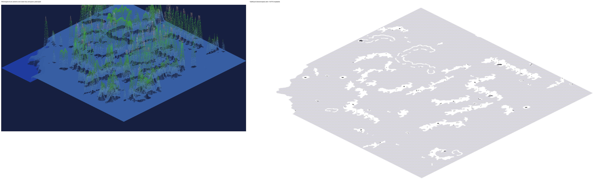
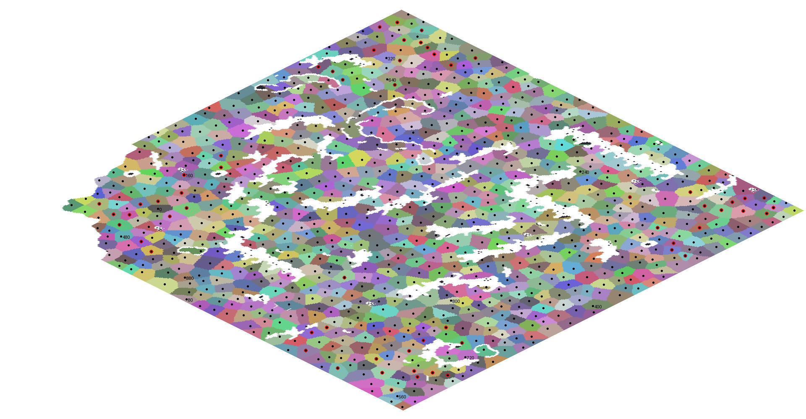
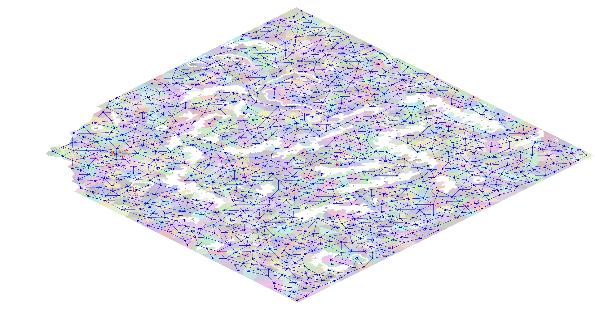
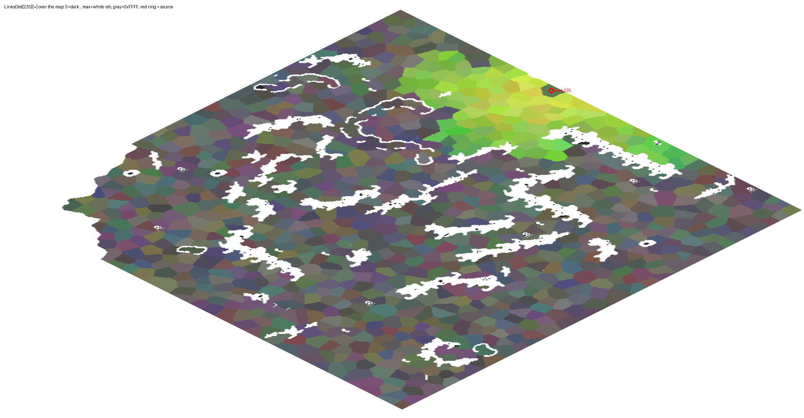
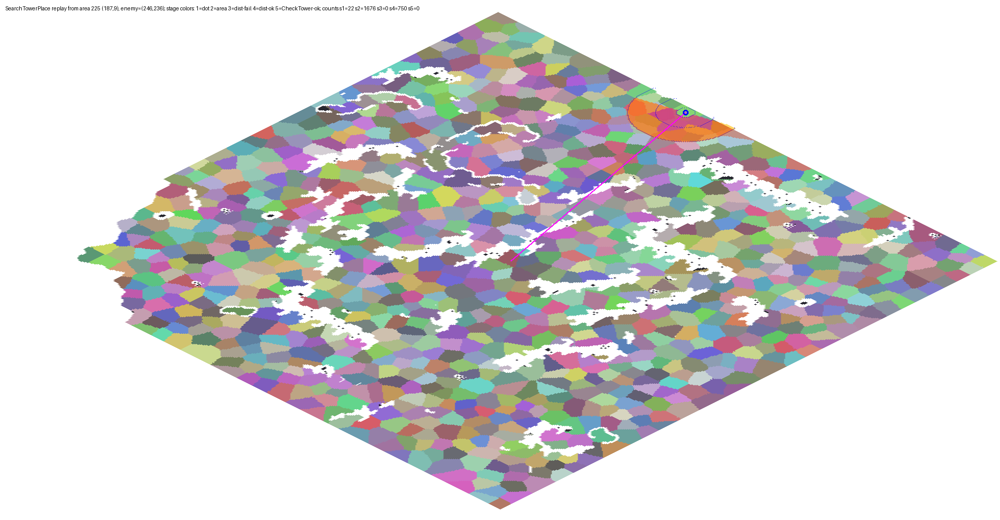

# The map's second skeleton: topology areas, links, and distances

This is a walk-through of the coarse "area graph" that the game builds on top
of the pixel map, and of everything that graph is used for. It assumes only
general programming knowledge plus [unit_rendering.md](unit_rendering.md) for
the coordinate vocabulary (length units, screen pixels, `RealX/RealY`). All
code references are to this repository; the numbers from the skirmish example
in section 7 are real, from a debug build's stdout.

## 0. The 60-second version

The raw map is a fine grid of passability bits. On top of it the game builds a
**coarse graph of "areas"** - connected blobs of walkable land - and then answers
almost every strategic question with that graph instead of the raw grid:

```
raw map (msx x msy fine cells, MFIELDS / InfoMap / CantBuild)
        |
        |  CreateAreas() - once per map, at map finalization
        |    seed random free spots  ->  Area { x, y, Link[], MinesIdx[], SINF[8] }
        |    flood-fill TopRef ring by ring (Rarr, radius 1..89)
        |    touching areas -> AddLink(a, b, Norma(center distance))
        v
TopRef[x + y*TopLx] : word per coarse cell
        0xFFFF = not yet assigned, 0xFFFE = impassable, <4096 = area id
        |
        |  CreateLinkInfo(): seed LinksDist/MotionLinks from direct links,
        |  relax with OneIteration() (at most 3 passes)
        v
LinksDist[a*NAreas + b]  : word, 0xFFFF = unreachable, diagonal stays 0xFFFF (!)
MotionLinks[a*NAreas + b]: next hop area on the way to b
        |
        |  kept up to date at runtime: walls/buildings lock cells
        |  (DynamicalLockTopCell), main loop calls ProcessDynamicalTopology()
        v
consumers: army pathfinding (brigade.cpp), mine capture, farm placement,
           building placement (SearchPlace/SearchTowerPlace), AI targeting
           and defense (megapolis.cpp, einfoclass.cpp), danger map (SafeMAP)
```

A normal map has a 256x256 topology grid and typically a few hundred to ~1000
areas (a skirmish map we instrumented had `NAreas = 960`; the hard cap in
`AddArea` is 1016).

## 1. Why two maps over one terrain

The fine layer already exists: `MFIELDS[]` (movement fields), `InfoMap`
(buildability bits, newai.cpp `CreateInfoMap`) and `CantBuild` (locked cells,
`CB_Sklad/CB_Building/CB_Mill`, newai.h). It is per-fine-cell and changes
whenever a building appears. Walking armies do use it directly for local
movement. But it is far too fine for questions like "which mine is closest to
my town", "can I reach that enemy by land", "where should a tower go" - those
want a graph, not a bitmap.

So the game derives a second, coarser map:

| | fine layer | topology layer |
|---|---|---|
| grid | `msx x msy` cells (normal map: 512x512 fine cells) | `TopLx x TopLy` = `(MAPSX>>2)` = 256x256 cells |
| cell size | 1 fine cell | 4x4 fine cells = 64 length units = 4 screen px |
| values | passability/buildability bits | `word TopRef`: `0xFFFF` unassigned, `0xFFFE` impassable, else area id (<4096) |
| built by | map load + `CreateInfoMap()` | `CreateAreas()` once per map |
| updated | continuously | incrementally, via `ProcessDynamicalTopology()` |

All figures below are rendered from the real map used by the case-study
saves `gamedata/taras.sav` and `gamedata/test.sav` - both store
`CurrentMap = "RN1 6F99 20210 000003JF 0000000.m3d"` (the `SaveMap` block of the
.sav, see [sav_format.md](sav_format.md)), a large random map (`ADDSH=2`).
`tools/m3d_areas.py` parses that `.m3d`'s `TOP1` chunk directly, so the areas,
links and distances you see are the ones actually stored in the file, not a
sketch. All figures are drawn in the game's own isometric (diamond)
projection - array cell `(x, y)` maps to screen `(x - y, (x + y) / 2)`, the
same transform the renderer applies to the map - so the landmass appears as
the diamond you see in-game, not as a square. The arrays are *stored* in this
diamond space: `TopRef` is indexed `x + (y << TopSH)` and `THMap` vertices get
their odd-column half-cell shear at draw time (`GetTriX`/`GetTriY`,
3dgraph.cpp), so no un-projection is needed to visualize them.



*Left: the `FRUS` height chunk (1024x1025 words, playable region 960x960 fine
cells) with the `0xFFFE` impassable cells darkened. Right: the `TopRef`
passability grid (480x480 playable cells inside the 512x512 array): dark =
`0xFFFE`, white = `0xFFFF` unassigned border.*

Map sizes are parameterized by `ADDSH`, taken from the map name digit in
`CreateMapByName` (3drandmap.cpp:1563: normal=1, large=2, huge=3):
`MAPSX = 512 << ADDSH` (loadsave.cpp:3456), `TopLx = MAPSX >> 2`,
`TopSH = 7 + ADDSH`. So the topology grid is 256x256, 512x512 or 1024x1024.

`GetTopology(x, y)` (brigade.cpp:512) is the lookup everyone uses: pixel
coordinates in, `x >> 6` to cell, `TopRef[x + (y << TopSH)]` out. If the cell
is impassable it scans rings up to radius 20 (`Rarr`) for the nearest valid
area, so a unit standing on a locked cell still maps to an area.
`SafeTopRef` (mapdiscr.h:2116) is the bounds-checked raw variant.

## 2. Creating the areas: seeds, flood fill, links

`CreateAreas()` (topograf.cpp:161) runs once when the map is finalized -
`CreateTotalLocking()` in 3dmaped.cpp:1144 calls it after `CreateMapLocking()`
and before `CreateInfoMap()` - and the result is serialized into the save file
(savenewmap.cpp / loadsave.cpp) and reloaded with it.

**Step 1 - impassable cells.** `TopRef` is memset to `0xFFFF` ("unknown"), then
every cell where `GetTCStatus(x,y)` is true is set to `0xFFFE` ("impassable").
`GetTCStatus` checks a 4x4 block of the movement field (`MFIELDS->CheckBar`)
plus an accurate 12-point `CheckPt` pattern - water, ridges, map border.

**Step 2 - seed areas.** Random points are rolled; a seed is accepted if its
3x3 neighborhood is entirely `0xFFFE` (free land). `AddArea(x, y, Sliv)`
(topograf.cpp:67) either merges the seed into an existing area within
`MinNorm` (7/10/15 cells for ADDSH 1/2/3 - averaging the center) or creates a
new `Area`. Seeding stops after 50 consecutive failed rolls. `NAreas` is
capped at 1016; `MaxArea` grows by 120 from 200. An `Area` is:

```cpp
struct Area {                 // topograf.h
    short x, y;               // center cell
    byte  Importance;         // mine bits: 1=gold, 2=iron, 4=coal
    byte  NTrees, NStones;
    word  NMines;  word* MinesIdx;   // resource sprites in this area
    word  NLinks;  word* Link;       // pairs {target area, weight}
    word  MaxLink;
    StrategyInfo SINF[8];            // per-nation strategic census, see sec. 5
};
```

**Step 3 - flood fill.** The loop `for (i = 1; i < RRad && Change; i++)` grows
every area by ring `i` using `Rarr[i]` - the precomputed ring-offset table
built by `CreateRadio()` (topograf.cpp:38): all (dx,dy) with
`int(sqrt(dx*dx+dy*dy)) == i`, for `RRad = 90`. A free cell (`0xFFFE`)
adjacent (8-neighborhood) to area `j` becomes `j`. When a cell of area `ZZ`
touches a cell of a *different* area `ZU`, both get a link:

```cpp
AddLink( ZZ, ZU );   // and AddLink( ZU, ZZ )
// AddLink: Link[N*2] = target; Link[N*2+1] = Norma(AR->x - TopMap[N2].x, AR->y - TopMap[N2].y);
```

So the **edge weight is the distance between area centers**, measured with
`Norma` - not Euclidean but the octagonal metric `(2*max + min)/2`
(newmon.h:10). Finally `TopRef[area center] = area id`.

**Step 4 - resources.** Every map sprite with `IntResType < 8` (a mine or
resource) is attached to the area containing its cell: `AR->NMines++`,
`MinesIdx[]`, and gold/iron/coal set `Importance` bits 1/2/4. This is how the
game knows "area 83 contains 2 gold mines" without scanning the map.

On the case-study map this produces **960 areas** (`NAreas=960` in the `TOP1`
chunk - exactly the `nareas=960` from the debug log), 4,960 directed links
with weights **min 11, max 39, mean 17.5**, and 60 mine-bearing areas (65 mine
references) (weights are `Norma` center distances, so they are small integers
by construction):



*Each color is one area of the real `RN1 6F99 ...` save; black dots are the
area centers (`Area.x/y`) where `TopRef` stores the id; red rings mark areas
with mine `Importance` bits. Dark cells are `0xFFFE`.*

## 3. The link matrices: `LinksDist` and `MotionLinks`

After the flood fill, `CreateLinkInfo()` (topograf.cpp:395) builds two
`NAreas x NAreas` word matrices, indexed `[from*NAreas + to]`:

* `LinksDist[a][b]` - shortest known distance from area `a` to `b`;
* `MotionLinks[a][b]` - the **next hop** area on the way from `a` to `b`
  (used by pathfinding: "to reach b, go to MotionLinks[a][b] first").

Both are memset to `0xFFFF` ("unreachable"), then seeded only with *direct*
links from `Area::Link` (`ClearLinkInfo`), then relaxed by `OneIteration()`:

```cpp
void CreateLinkInfo() {
    ClearLinkInfo();
    int N, p = 0;
    do { ProcessMessages(); N = OneIteration(); p++; } while (N && p < 3);  // at most 3 passes!
    ...
}
```

`OneIteration` is a Bellman-Ford-style pass over all pairs, relaxing
`LinksDist[i][j] = min(..., LinksDist[N2][j] + linkWeight(i,N2))` and recording
the next hop in `MotionLinks`. Two quirks worth knowing (both now documented in
a comment at `ClearLinkInfo` in this repo):

1. **The diagonal is never written.** `OneIteration` skips `i == j`, and the
   memset leaves `LinksDist[a][a] = 0xFFFF`, not 0. Every caller that cares
   must special-case "same area" itself - `SearchPlace` does
   (`if (top == REALMYTOP) TDST = 0;`), and after the bug in section 7 so does
   `SearchTowerPlace`.
2. **Only up to 3 relaxation passes run** (`p < 3`), so pairs farther than
   what 3 Gauss-Seidel passes can propagate keep `0xFFFF` even when a path
   exists. In practice the grid-like area graph has small diameter, so this
   rarely matters - but "0xFFFF" therefore means "unknown/unreachable", not
   necessarily "no path".

**Water gets its own copy.** `CreateWTopMap()` (topograf.cpp:1234) builds the
same structure over `MFIELDS[1]` (water): `GTOP[1]` with `WTopRef`, `WTopMap`,
`WNAreas`, `WMotionLinks`, `WLinksDist`. Ships pathfind on it
(brigade.cpp:5052, einfoclass.cpp:1193). In the save this is the separate
`WPOT` chunk.



*The real link graph of `RN1 6F99 ...` overlaid on the area map (dimmed). Edge
labels are the stored link weights - note they are all small integers
(center-distance metric).*



*`LinksDist[225][*]` from the saved matrices, drawn over the map: distance 0
is darkest, larger distances fade to yellow, gray = `0xFFFF` unreachable. The
red ring is source area 225 at (187,9) - a top-edge area whose nearest linked
area is 17 away (min link weight 17). You can also see the saved diagonal:
`LinksDist[a][a]` is `0xFFFF` for every area (740,797 of 921,600 matrix entries
in this map are `0xFFFF` overall) - exactly the quirk that broke first-tower
placement in section 7.*

## 4. Islands

`ResearchIslands()` (brigade.cpp:3663) runs a graph traversal (`ArrangeAreas`)
over `Area::Link` and labels every area with an island id in `TopIslands[]`,
then computes island centers. This is the answer to "is that enemy reachable
by land at all" - if his area is on a different island, only ships can get
there.

## 5. Per-area strategic census: `StrategyInfo`

`CreateStrategyInfo()` (topograf.cpp:449) walks all objects, maps each to its
area via `TopRef`, and fills `Area::SINF[nation]`:

```cpp
struct StrategyInfo {
    word BuildInfo;      // SI_Center|SI_Meln|SI_Tower|SI_Shahta|... which building types exist here
    byte NPeasants, NShortRange, NLongRange, NMortir, NTowers, NPushek;
};
```

Afterwards it propagates `SI_Near` to all directly linked areas, so the AI
can tell "the neighboring area has a tower" without rescanning. The AI's
attack/defense code in megapolis.cpp (e.g. lines 4488, 4816, 4959, 5044-5138)
reads these to pick targets and to decide when an army can "connect" to an
attack group (`MotionLinks[MyTop*NAreas + HisTop]`).

## 6. Who consumes the graph

| question | code | uses |
|---|---|---|
| army route between distant points | brigade.cpp:1120, 1226, 1512, 2999 | `MotionLinks[from][to]` as next hop, recursively |
| ship route | brigade.cpp:5052, einfoclass.cpp:1193 | `GTOP[1].MotionLinks` (water graph) |
| can I capture this mine? | megapolis.cpp:3043 | mine's area reachable (`MotionLinks != 0xFFFF`) and within `MINE_CAPTURE_RADIUS` |
| where to put the next farm | `City::GetNextPlaceForFarm` (megapolis.cpp:261) | ring search, accept cell if `LinksDist[townArea][cellArea] - min < 30` |
| where to build | `SearchPlace` / `SearchTowerPlace` / `CheckTower` (newai.cpp) | ring search + `GetTopology` + `LinksDist` slack + `GetSafeVal` |
| where is the nearest enemy | `GlobalEnemyInfo::FindNearestEnemy` (einfoclass.cpp:126) | ranks enemy armies/objects by `LinksDist[enemyArea][myArea]` |
| is this cell safe to build on | `EnemyInfo::GetSafeVal` (einfoclass.cpp:829) | `SafeMAP` danger bitmap (built from enemy objects, dilated by 1 ring, refreshed every 256 ticks) |
| attack/defense decisions | megapolis.cpp:4488+ | `MotionLinks` hops + `SINF` census |
| resource claiming | mapsprites.cpp:969, 1366 | `LinksDist < 30 / < 20` reachability |

**Dynamical updates.** When a wall or building is created/destroyed,
walls.cpp calls `DynamicalLockTopCell` / `DynamicalUnLockTopCell`
(topograf.cpp:590+): the cell flips between `0xFFFF` (locked) and `0xFFFE`
(free), and the area plus its neighbors are queued in `ChAreas`. Every frame
the main loop calls `ProcessDynamicalTopology()` (main.cpp:1901), which remakes
only the affected area groups (`RemakeGroupOfAreas`) and re-relaxes distances
locally (`OnePartIteration` on temporary matrices, `LimitedClearBadLinks`).
So the graph - and therefore pathfinding, mine capture and placement - reacts
to new buildings within a frame or two, without rebuilding the whole map.

## 7. Case study: why Austria never built towers (and the fix)

This section is the field report from an actual skirmish (land map, no peace
time, Hungary vs Austria). The save files from those games -
`gamedata/taras.sav` and `gamedata/test.sav` - both name the same map in their
`SaveMap` block: `CurrentMap = "RN1 6F99 20210 000003JF 0000000.m3d"`, a
large (`ADDSH=2`) random map whose stored `TOP1` chunk has `NAreas=960` -
matching the `nareas=960` in the log below. (Area *ids* differ between the
log and the saved file because the graph is rebuilt from the terrain at game
start, so the runtime `mytop=83` is a different numbering of the same map;
the figures in this chapter use the saved numbering.) With temporary printf
instrumentation the logs showed:

```
TOWDBG nat=2 AIID=AUSTRIA.0
TOWDBG nat=2 land=0 ... tow=0/0 eq=0 freeproxy=225 ...   <- AI gate passes, TryUnit accepted
TOWDBG STP nat=2 FAIL at 223,14 enemy 59,61 mytop=83 nareas=960
         same-area=0 ... top-ok=1187 tdst-ok=0 ... minTDST=14
TOWDBG nat=2 TOWERPLACE res=0 nports=0 cx=223 cy=14 -> 223,14
```

Reading it against the code: the AI side was fine (identical script to
Hungary's, proposal accepted). The tower died in `SearchTowerPlace`
(newai.cpp:382), which is used **only for a nation's first tower(s)** - once
`NPORTS > 1` (two or more existing towers) it switches to plain `SearchPlace`:

```cpp
if (NPORTS > 1) return SearchPlace( xx1, yy1, SFN, r );
```

The strict path searches rings 6..39 around the town center, but only cells on
the **enemy-facing half-plane** (`(xx-xc)*(xe-xc) + (yy-yc)*(ye-yc) > 0`),
that are danger-free (`GetSafeVal`), in a valid area, and whose area distance
passes `TDST - PrevTopDst < 14`. Austria's base sat at (223,14) - the top map
edge - in area 83. The counters showed why every candidate failed:

* `same-area=0`: area 83 was so small that no cell of it lay in the searched
  half-plane, and - the original bug - same-area cells would have had
  `TDST = LinksDist[83*NAreas + 83] = 0xFFFF` (diagonal!) anyway;
* `minTDST=14`: the nearest linked area was exactly 14 away, failing `< 14`.

Result: `res=0` forever, `NPORTS` never exceeded 1, so the working
`SearchPlace` path was never reached - a nation that **can never build its
first tower**, purely because of where its base happened to generate. Hungary's
base area was small and well-linked, so it passed.

The fix (in this repo, newai.cpp) mirrors what `SearchPlace` already did:

```cpp
int MyArea = MyTop;               // before MyTop *= NAreas
...
int TDST = LinksDist[MyTop + top];
if (top == MyArea) TDST = 0;      // same area = distance 0 (diagonal is 0xFFFF)
if (TDST - PrevTopDst < 24)       // same slack as SearchPlace (was < 14)
...
return SearchPlace( xx1, yy1, SFN, r );   // last resort instead of return false
```

After the fix the same map logs `TOWERPLACE res=1` and towers appear on the
attack side of the base (south), as they should.



*`SearchTowerPlace` replayed from area 225 at (187,9) of `RN1 6F99 ...`, enemy
taken as the centroid of all area centers (magenta line). Ring cells are
colored by the furthest filter stage they pass: dot-product (yellow) -> valid
area (orange) -> topology distance `< 24` with same-area = 0 (purple) ->
distance ok (dark pink) -> `CheckTower` 2x2 walkable (green). The blue circles
mark the search rings 6/20/39. Note this area's nearest link is 17 away: with
the original `< 14` threshold no candidate would pass stage 3 at all - the
exact case-study failure (`tdst-ok=0, minTDST=14` in the runtime log; area ids
differ because the graph is rebuilt at game start, but the geometry is the
same). With the fixed `< 24` slack, stages 4-5 do pass and a tower spot is
found on the enemy-facing side.*

## 8. Why it looks like this, and what it would be today

The area graph is the 2001 answer to "pathfinding and strategy on a 512x512+
grid in software, every tick". A coarse graph turns O(map) questions into
O(areas) or O(1) matrix lookups; `LinksDist`/`MotionLinks` are just a tiny
Floyd-Warshall/Bellman-Ford and next-hop table, capped at 3 passes because
areas are grid-adjacent and the diameter is small. The `0xFFFF` sentinels and
the missing diagonal are exactly the kind of thing that survives when the
original authors special-case same-area at each *use site* (as einfoclass.cpp
and `SearchPlace` do) and forget one - which is what section 7 caught.

| technique here | modern equivalent |
|---|---|
| coarse area graph over a fine grid | navigation meshes / flow fields in modern RTS (e.g. Supreme Commander's flowfield, StarCraft 2's influence maps) |
| `LinksDist` + `MotionLinks` next-hop matrices | all-pairs shortest paths on a navmesh region graph (HPA* - hierarchical pathfinding, exactly this idea) |
| ring tables `Rarr[90]` for flood fill / searches | precomputed offset tables, or just `std::vector` of ring offsets; modern engines use jump-point search on grids instead |
| per-area strategic census (`SINF`) + `SI_Near` propagation | influence maps / tactical point analysis |
| dynamical lock/unlock of single cells with local re-relaxation | incremental navmesh updates (carving) in Unity/Unreal |
| separate water graph `GTOP[1]` | separate navmesh layers for land/sea |

The part that does **not** survive is trusting a 3-pass relaxation and a
never-written diagonal; a modern implementation would initialize the diagonal
to 0 and run until convergence, which is precisely the one-line class of fix
applied in `SearchTowerPlace` here.
